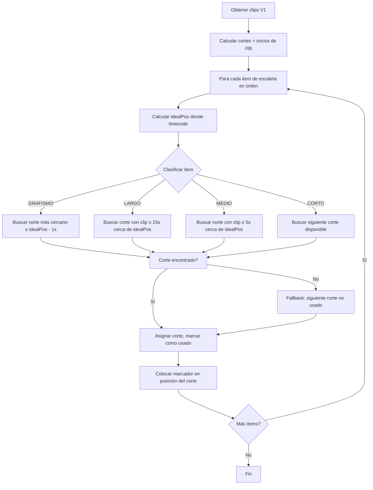

# Plan: Algoritmo de Snap a Cortes (Cut-Aware Marker Placement)

## Problema

Actualmente los marcadores se colocan en posiciones calculadas como offset desde el timecode de la escaleta (`0.00s, 16.00s, 22.00s, ...`), pero estas posiciones **no coinciden con los cortes reales del timeline** (inicios de clip en V1). Esto hace que los marcadores queden en medio de clips en vez de alineados con los límites de bloque.

## Objetivo

Que cada marcador se posicione en el **inicio del clip de V1** que mejor corresponda según el tipo de ítem, usando los cortes reales del timeline.

## Datos de Entrada

### 1. Clips V1 (desde `getTrackClips(1, "video")`)
Cada clip tiene: `start`, `end`, `duration = end - start`, `inPoint`, `outPoint`

Del ejemplo:
```
Clip 0:  0.00-17.00   dur=17.00s  ← corte en 17.00
Clip 1: 17.00-61.48   dur=44.48s  ← corte en 61.48 (LARGO)
Clip 2: 61.48-75.36   dur=13.88s  ← corte en 75.36 (MEDIO)
Clip 3: 75.36-77.16   dur=1.80s   ← corte en 77.16 (CORTO)
Clip 4: 77.16-103.60  dur=26.44s  ← corte en 103.60 (LARGO)
Clip 5: 103.60-103.72 dur=0.12s   ← FLASH / residual
Clip 6: 103.72-120.56 dur=16.84s  ← corte en 120.56 (MEDIO)
Clip 7: 120.56-123.24 dur=2.68s   ← desde aquí clips cortos (VIDEO)
...
```

### 2. Items de escaleta (con tipos inferidos del bloque)
Cada item tiene: `num`, `titol`, `horaEntradaPrevista`, `durada`, `agrupacio`, tipo de bloque asociado

### 3. Mapeo item → tipo de bloque (desde la estructura)
Los tipos de bloque se conocen del structure: INTRO, DIFERIT, DONAPAS, CONNEXIO, INSERT, VIDEO, IPD, etc.

## Algoritmo Propuesto: Snap por Categoría de Duración

### Paso 1: Clasificar cada ítem por "categoría de clip esperada"

| Categoría | Tipos de bloque | Duración de clip esperada | Comportamiento de snap |
|-----------|-----------------|---------------------------|------------------------|
| **LARGO** | INTRO, DIFERIT | ≥ 15s | Snap al inicio del clip largo más cercano después de la posición ideal |
| **MEDIO** | DONAPAS, CONNEXIO, INSERT | ≥ 5s y < 15s | Snap al inicio del clip medio más cercano |
| **CORTO** | VIDEO, IPD | < 5s | Snap al siguiente corte disponible (cualquier clip) |
| **GRAFISMO** | (agrupacio=null, duracion=0) | N/A | Snap al corte más cercano después del item padre, con separación de 4s entre sí |

### Paso 2: Algoritmo greedy de asignación

```
cortes = clips.map(c => c.start)  // [0, 17.00, 61.48, 75.36, 77.16, 103.60, 103.72, 120.56, ...]
cortesUsados = []  // índices de cortes ya asignados

para cada item (en orden de escaleta):
    idealPos = calcularPosicionIdeal(item)  // lógica actual
    categoria = clasificarItem(item)
    
    // Encontrar el mejor corte
    mejorCorte = null
    mejorIdx = -1
    
    para cada corte en cortes (empezando desde el último usado + 1):
        si corte >= idealPos - tolerancia:
            duracionClip = clips[idx].duration
            si duracionClip >= duracionMinimaPara(categoria):
                si corte no está en cortesUsados:
                    mejorCorte = corte
                    mejorIdx = idx
                    break
    
    // Fallback: si no se encontró, tomar el siguiente corte disponible
    si mejorCorte es null:
        mejorIdx = encontrarSiguienteCorteDisponible()
        mejorCorte = cortes[mejorIdx]
    
    cortesUsados.push(mejorIdx)
    item.posicionFinal = mejorCorte
```

### Paso 3: Lógica específica para cada categoría

#### LARGO (INTRO, DIFERIT)
```javascript
function encontrarCorteLargo(idealPos, cortes, clips, ultimoCorteUsado) {
    for (let i = ultimoCorteUsado + 1; i < cortes.length; i++) {
        if (cortes[i] >= idealPos - 2.0) { // tolerancia 2s
            const dur = clips[i].end - clips[i].start;
            if (dur >= 15) return { corte: cortes[i], idx: i };
        }
    }
    // Fallback: siguiente corte disponible
    return encontrarSiguienteCorte(idealPos, cortes, ultimoCorteUsado);
}
```

#### MEDIO (DONAPAS, CONNEXIO, INSERT)
```javascript
function encontrarCorteMedio(idealPos, cortes, clips, ultimoCorteUsado) {
    for (let i = ultimoCorteUsado + 1; i < cortes.length; i++) {
        if (cortes[i] >= idealPos - 2.0) {
            const dur = clips[i].end - clips[i].start;
            if (dur >= 5) return { corte: cortes[i], idx: i };
        }
    }
    // Fallback
    return encontrarSiguienteCorte(idealPos, cortes, ultimoCorteUsado);
}
```

#### CORTO (VIDEO, IPD)
```javascript
function encontrarCorteCorto(idealPos, cortes, ultimoCorteUsado) {
    // Simplemente el siguiente corte disponible después de idealPos
    for (let i = ultimoCorteUsado + 1; i < cortes.length; i++) {
        if (cortes[i] >= idealPos - 1.0) {
            return { corte: cortes[i], idx: i };
        }
    }
    return null;
}
```

#### GRAFISMO (agrupacio=null, duracion=0)
```javascript
function encontrarCorteGrafismo(idealPos, cortes, ultimoCorteUsado, separacionMinima = 4) {
    // El idealPos ya incluye la separación de 4s entre grafismos
    for (let i = ultimoCorteUsado + 1; i < cortes.length; i++) {
        if (cortes[i] >= idealPos - 1.0) {
            return { corte: cortes[i], idx: i };
        }
    }
    return null;
}
```

### Paso 4: Integración en `placeStructureMarkers`

El cambio principal está en el bucle de colocación de marcadores (líneas 1005-1055 de `flow_assembly.js`):

```javascript
// Antes del bucle de items, obtener los cortes de V1
const clips = await getClipsLogic().getTrackClips(1, "video");
const cortes = clips.map(c => c.start);  // [0, 17.00, 61.48, ...]
let ultimoCorteUsado = -1;

for (const line of lines) {
    const horaRef = line.horaEntradaOnAir || line.horaEntradaPrevista;
    if (!horaRef || horaRef === "00:00:00") continue;
    
    const idealPos = calcularIdealPos(line); // lógica actual (0, 16, 22, ...)
    const categoria = clasificarItem(line, block); // LARGO | MEDIO | CORTO | GRAFISMO
    
    const resultado = snapToCut(idealPos, cortes, clips, categoria, ultimoCorteUsado);
    const posicionFinal = resultado.corte;
    ultimoCorteUsado = resultado.idx;
    
    // Colocar marcador en posicionFinal (en vez de safeT)
    log(`📍 Línia ${num}: ${horaRef} → cortado en ${posicionFinal.toFixed(2)}s (ideal era ${idealPos.toFixed(2)}s)`);
    // ... colocar marcador con color
}
```

## Mapa de Clasificación de Items

El clasificador necesita saber, para cada línea de escaleta, qué tipo de bloque tiene asociado. Esto se obtiene del `block` actual y de la estructura.

Propuesta de función `clasificarItem`:

```javascript
function clasificarItem(line, block, mergedStruct) {
    // 1. GRAFISMO: agrupacio=null y duracion=0
    const dStr = line.durada || line.duradaOnAir || "0:00";
    const dSec = parseDurada(dStr);
    if (!line.agrupacio && dSec === 0) return 'GRAFISMO';
    if (!line.agrupacio && dSec > 0) return 'NO_VERTICALIZABLE'; // ROJO, se mantiene igual
    
    // 2. Usar el tipo del bloque para determinar categoría
    const blockType = block ? (block.type || '') : '';
    
    switch(blockType.toUpperCase()) {
        case 'INTRO':
        case 'DIFERIT':
            return 'LARGO';
        case 'DONAPAS':
        case 'CONNEXIO':
        case 'INSERT':
            return 'MEDIO';
        case 'VIDEO':
        case 'IPD':
            return 'CORTO';
        default:
            // Si no hay tipo de bloque, inferir de la duración del ítem
            if (dSec > 20) return 'LARGO';
            if (dSec > 5) return 'MEDIO';
            return 'CORTO';
    }
}
```

## Tolerancias y Umbrales (configurables)

| Parámetro | Valor | Descripción |
|-----------|-------|-------------|
| `toleranciaLargo` | 2.0s | Distancia máxima para snap a clip largo |
| `toleranciaMedio` | 2.0s | Distancia máxima para snap a clip medio |
| `toleranciaCorto` | 1.0s | Distancia máxima para snap a clip corto |
| `toleranciaGrafismo` | 1.0s | Distancia máxima para snap de grafismo |
| `minDurLargo` | 15s | Duración mínima de clip para considerar "largo" |
| `minDurMedio` | 5s | Duración mínima de clip para considerar "medio" |
| `maxDurMedio` | 15s | Duración máxima de clip para considerar "medio" (por encima es "largo") |
| `separacionGrafismos` | 4s | Separación entre grafismos consecutivos |

## Diagrama de Flujo



## Consideraciones

1. **Grafismos múltiples**: Los grafismos (01chy, 01gf1, 01te, 01td) comparten timecode y actualmente se separan 4s. Con snap a cortes, se asignarán a cortes consecutivos (si hay suficientes) o se mantendrá la separación de 4s como fallback.

2. **Clips muy cortos (< 1s)**: Probablemente son flashes o residuos del scene detection. El algoritmo debe saltarlos o tratarlos como parte del clip anterior. Propuesta: si `clip.duration < 1.0`, no se considera un corte válido para LARGO/MEDIO, solo para CORTO.

3. **Primer clip**: El clip 0 (0.00-17.00) es el "pre-roll" o intro del bloque general. El marcador del primer item (01dp) debería ir al corte en 17.00s (inicio del clip 1).

4. **Caso borde**: Si no hay suficientes cortes para todos los items, los items extra se colocan con la lógica actual (offset desde idealPos).

## Implementación

Los cambios se concentran en una única función nueva dentro de `flow_assembly.js`:

- `snapToCut(idealPos, cortes, clips, categoria, ultimoCorteUsado)` → devuelve `{corte, idx}`
- Modificar el bucle de items en `placeStructureMarkers` para usar esta función

No se requieren cambios en otros archivos ni en la estructura de datos.
