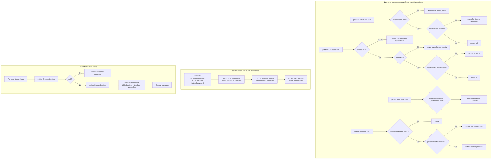

# PLAN: Corregir clip truncado que excluye items sin OnAir

## Diagnóstico

**Problema**: El clip MP4 se trunca antes del último item real del bloque cuando ese item no tiene `horaEntradaOnAir` (ej: HANTAVIRUS, fuente BV).

**Causa raíz**: En [`calcPrecisionTrimBounds`](js/core/escaleta_reader.js:726-728), `videoItemsInBlock` filtra por `teVideo===true && horaEntradaOnAir`:

```javascript
const videoItemsInBlock = blockLines.filter(l =>
    l.teVideo === true && l.horaEntradaOnAir
);
```

Si el último item del bloque (ej: HANTAVIRUS, `durada="2:04"`, `teVideo=true`) no tiene `horaEntradaOnAir`:

1. **Tier1-OUT** ([line 874](js/core/escaleta_reader.js:874)): usa el último item CON OnAir (ej: "01dir"), ignorando HANTAVIRUS
2. `OutTier=1` → **Tier2 y Tier3 no se ejecutan** (requieren `OutTier === 0`)
3. El `mp4ExpandedOutPoint` se calcula al final de "01dir", truncando el clip
4. HANTAVIRUS queda fuera del clip insertado

**Efecto secundario en marcadores**: [`placeMarksCrudo`](js/workflows/flow_assembly.js:1873) SÍ incluiría a HANTAVIRUS (tiene `horaEntradaPrevista` y `durada>0`, pasa ambos filtros), pero el marcador se coloca en una posición del timeline donde ya no hay clip → invisible para el usuario.

## Solución propuesta

### Principio general

Separar claramente dos conceptos:

| Concepto | Descripción | Items que aplican |
|----------|-------------|-------------------|
| **Items estructurales** (secuenciales) | Ocupan tiempo lineal en el timeline | `getRawDuradaSec(item) > 0` |
| **Items superpuestos** (IPD/grafismos) | Se solapan sobre items estructurales | `getRawDuradaSec(item) === 0` |

Para los **bounds del clip** (IN/OUT), solo los items **estructurales** importan. Los IPD/grafismos viven dentro del rango de su padre y no expanden bounds.

Para los **marcadores**, TODOS los items del bloque deben tener marcador (estructurales, IPD y grafismos), cada uno en su posición correcta y con su clasificación correspondiente.

### Arquitectura



## Pasos de implementación

### Paso 1: Crear funciones de resolución en [`escaleta_reader.js`](js/core/escaleta_reader.js)

Añadir después de `secondsToTC` (o al final, antes del cierre del objeto):

**a) `getItemEntradaSec(item)`**
- Si `item.horaEntradaOnAir` existe y no es "00:00:00": devolver `tcToSeconds(horaEntradaOnAir)`
- Sino, si `item.horaEntradaPrevista` existe y no es "00:00:00": devolver `tcToSeconds(horaEntradaPrevista)`
- Sino: devolver `null`

**b) `getItemDuradaSec(item)`**
- Si `item.duradaOnAir` existe y su parseDurada > 0: devolver `parseDurada(duradaOnAir)`
- Sino, si `item.durada` existe y su parseDurada > 0: devolver `parseDurada(durada)` 
- Sino: devolver `parseDurada(item.durada || '0:00')` (que será 0)

**c) `getItemSortidaSec(item)`**
- `var entradaSec = this.getItemEntradaSec(item); if (entradaSec === null) return null;`
- `var duradaSec = this.getItemDuradaSec(item);`
- `return entradaSec + duradaSec;`

**d) `isItemEstructural(item)`**
- `return this.parseDurada(item.durada || '0:00') > 0;`
- Nota: usa `durada` literal (RAW), no `duradaOnAir`. Porque los IPD tienen `durada="0:00"` pero `duradaOnAir≠null`. Queremos que los IPD NO sean estructurales aunque tengan duradaOnAir.

### Paso 2: Modificar [`calcPrecisionTrimBounds`](js/core/escaleta_reader.js:698)

**a) Calcular items estructurales del bloque** (reemplazar `videoItemsInBlock`):

```javascript
// En lugar de:
const videoItemsInBlock = blockLines.filter(l =>
    l.teVideo === true && l.horaEntradaOnAir
);

// Usar:
const structuralItemsInBlock = blockLines.filter(l =>
    this.isItemEstructural(l)
);
```

**b) IN - Tier 0**: Sin cambios (ya busca cualquier item anterior con OnAir, independientemente del bloque actual). Este tier es el más fiable porque usa datos de emisión real del item anterior.

**c) IN - Tier 1** ([line 793](js/core/escaleta_reader.js:793)): Usar `structuralItemsInBlock` en lugar de `videoItemsInBlock`:

```javascript
if (InTier === 0) {
    if (structuralItemsInBlock.length > 0) {
        const firstItem = structuralItemsInBlock[0];
        var firstEntrada = this.getItemEntradaSec(firstItem);
        if (firstEntrada !== null) {
            worldBlockStartSec = firstEntrada;
            InTier = 1;
        }
    }
}
```

**d) IN - Tier 1b** ([line 804](js/core/escaleta_reader.js:804)): Sin cambios (block.in cuando no hay items).

**e) OUT - Tier 1** ([line 874](js/core/escaleta_reader.js:874)): Usar `structuralItemsInBlock` en lugar de `videoItemsInBlock`:

```javascript
if (structuralItemsInBlock.length > 0) {
    const lastItem = structuralItemsInBlock[structuralItemsInBlock.length - 1];
    var lastSortida = this.getItemSortidaSec(lastItem);
    if (lastSortida !== null) {
        worldBlockEndSec = lastSortida;
        OutTier = 1;
    }
}
```

**f) OUT - Tier 2, 2b, 3**: Sin cambios (son fallbacks cuando no hay items estructurales).

**g) Límite block.out** ([line 953](js/core/escaleta_reader.js:953)): Sin cambios. Sigue siendo el límite superior absoluto. Si HANTAVIRUS (`horaSortidaPrevista=21:05:40`) está DENTRO de block.out, no se trunca. Si block.out es anterior, se trunca correctamente.

### Paso 3: Limpiar [`placeMarksCrudo`](js/workflows/flow_assembly.js:1779)

**a) Usar `getItemEntradaSec`** en lugar de la lógica inline:

```javascript
// En lugar de:
var horaRef = line.horaEntradaOnAir || line.horaEntradaPrevista;
if (!horaRef || horaRef === "00:00:00") continue;

// Usar:
var itemOnAirSec = reader.getItemEntradaSec(line);
if (itemOnAirSec === null) continue;
```

**b) Usar `getItemDuradaSec`** en lugar de `parseDurada(line.durada || '0:00')`:

```javascript
// En lugar de:
var dSec = parseDurada(line.durada || '0:00');
if (dSec <= 0) continue; // Solo estructurales

// Usar:
var dSec = reader.getItemDuradaSec(line);
// NOTA: Quitar el filtro dSec <= 0 para permitir IPDs y grafismos
```

**c) Añadir clasificación de color** según el tipo de item (opcional, para mejorar la depuración):
- Estructurales (`isItemEstructural`): color azul (6) como antes
- IPDs (`durada=0` + `agrupacio` + `duradaOnAir`): color turquesa (7)
- Grafismos (resto): color amarillo (4)

Esto alinea `placeMarksCrudo` con la clasificación de [`ITEM_CLASSIFICATION.md`](docs/specs/ITEM_CLASSIFICATION.md:26-32).

### Paso 4: Verificar con TN_VESPRE_20260505

1. Ejecutar NOU con TN Vespre
2. Verificar que el clip insertado cubre hasta HANTAVIRUS (horaSortidaPrevista 21:05:40)
3. Ejecutar marksCrudo
4. Verificar que HANTAVIRUS tiene marcador en la posición correcta
5. Comparar todos los marcadores con los datos del JSON

## Riesgos y consideraciones

| Riesgo | Impacto | Mitigación |
|--------|---------|------------|
| IPD al inicio del bloque podría desplazar IN si se trata como estructural | Bajo | `isItemEstructural` usa `durada` literal (RAW), los IPD tienen `durada="0:00"` → no son estructurales |
| Item sin OnAir ni Prevista ni durada se queda fuera | Bajo | Es correcto: no hay datos para posicionarlo. El marcador se omite. |
| block.out puede ser incorrecto y truncar items válidos | Medio | Ya es el comportamiento actual. Si block.out está mal, es problema de la escaleta, no del algoritmo. |
| Cambiar `videoItemsInBlock` por `structuralItemsInBlock` podría incluir items no-video (caretas, donapas) como estructurales para OUT | Medio | Los donapas (`num` contiene "dp") tienen `durada>0` y son estructurales. Es correcto que expandan bounds. Las caretas también. |

## Resumen de cambios por archivo

### [`js/core/escaleta_reader.js`](js/core/escaleta_reader.js)

| Línea | Cambio |
|-------|--------|
| ~1048 | Añadir `getItemEntradaSec(item)`, `getItemDuradaSec(item)`, `getItemSortidaSec(item)`, `isItemEstructural(item)` |
| 726 | Cambiar `videoItemsInBlock` por `structuralItemsInBlock` |
| 796 | Tier1-IN: usar `structuralItemsInBlock` + `getItemEntradaSec` |
| 876 | Tier1-OUT: usar `structuralItemsInBlock` + `getItemSortidaSec` |

### [`js/workflows/flow_assembly.js`](js/workflows/flow_assembly.js)

| Línea | Cambio |
|-------|--------|
| 1875 | Usar `reader.getItemEntradaSec(line)` en lugar de filtro inline |
| 1878 | Usar `reader.getItemDuradaSec(line)` en lugar de `parseDurada(line.durada)` |
| 1879 | Eliminar `if (dSec <= 0) continue` |
| 1882 | Usar `reader.tcToSeconds(horaRef)` → ya usa `itemOnAirSec` calculado antes |
| 1900 | Añadir clasificación y color según tipo de item |
