# Plan: Corrección del Posicionamiento de Marcadores en `placeStructureMarkers`

**Versión:** 2.2 — 11/05/2026
**Estado:** PENDIENTE DE IMPLEMENTACIÓN

---

## 1. Resumen Ejecutivo

`placeStructureMarkers` coloca los marcadores en posiciones incorrectas por **dos bugs independientes** que se combinan:

1. **Acumulador aditivo** (`snappedPosSec + dSec`) en lugar de fórmula OnAir → propaga cualquier error de snap en cascada
2. **`snapToCut` unilateral (forward-only)** con solo 2s de margen hacia atrás → ignora cortes cercanos que quedan ligeramente antes del ideal

Además, `calcDensityFootprint` usa ventanas fijas de 30s demasiado gruesas, perdiendo cambios de densidad en puntos intermedios.

---

## 2. Diagnóstico Detallado del Bloque V1

### 2.1 Datos reales de la escaleta (JSON)

| Item | `num` | `horaEntradaPrevista` | `horaEntradaOnAir` | `durada` | `duradaOnAir` |
|------|-------|----------------------|---------------------|----------|---------------|
| LEAD IMATGES BONES ARRIBADA | 01lead | 21:07:17 | 21:07:17 | 0:50 | 0:44 |
| donapas YOLANDA MARZABAL | 02dp | 21:08:01 | null | 0:35 | null |
| DIRECTE TENERIFE PORT GRANADILLA DE ABONA | 02dir | 21:08:36 | null | 1:00 | null |
| +++IPD PORT TENERIFE+++++ | 02 | 21:09:04 | 21:09:04 | 0:00 | 0:45 |
| COM HA ANAT L'OPERATIU I VEÏNS | 03 | 21:10:37 | 21:10:37 | 1:44 | 1:46 |

### 2.2 Comparativa: Dónde ESTÁN vs Dónde DEBERÍAN estar

| # | Item | Donde ESTÁ | Donde DEBERÍA estar | Delta | Clip real |
|---|------|-----------|---------------------|-------|-----------|
| 0 | 01lead | **0.00s** | 0.00s | ✅ 0s | Clip 0 (start=0.00s) |
| 1 | 02dp (Yolanda) | **85.40s** (1:25:10) | **42.92s** (42:23) | ❌ +42.48s | Clip 23 start=42.92s |
| 2 | 02dir (Directe) | **127.92s** (2:07:23) | **85.40s** (1:25:10) | ❌ +42.52s | Clip 24 start=85.40s |
| 3 | 02 (IPD Tenerife) | **137.36s** (2:17:09) | **105.64s** (1:45:16) | ❌ +31.72s | Clip 25 start=105.64s |
| 4 | 03 (Com ha anat) | **187.92s** (3:07:23) | **199.20s** (3:19:05) | ❌ -11.28s | Clip 35 start=199.20s |

### 2.3 Clips del timeline relevantes

| Clip | start (timeline) | dur | Notas |
|------|-----------------|-----|-------|
| 22 | 39.64s | 3.28s | |
| **23** | **42.92s** | **42.48s** | ← Debería ser inicio de 02dp (donapas largo) |
| 24 | 85.40s | 20.24s | ← Debería ser inicio de 02dir (conexión, clip medio) |
| 25 | 105.64s | 4.60s | ← Debería ser inicio de IPD |
| 30 | 127.92s | 9.44s | |
| 34 | 151.52s | 47.68s | |
| 35 | 199.20s | 4.96s | ← Debería ser inicio de 03 |

### 2.4 BUG PRINCIPAL: `snapToCut` es unilateral (forward-only)

**Archivo:** [`js/workflows/flow_assembly.js`](js/workflows/flow_assembly.js:958)
**Líneas:** 958-1006

`snapToCut` tiene 3 fases secuenciales. El bug está en la **Fase 2**:

```javascript
// FASE 2 (líneas 974-984): búsqueda forward-only
for (let i = lastUsedClipCut + 1; i < clipCuts.length; i++) {
    const corte = clipCuts[i];
    if (corte >= additPosSec - clipLengthThreshold) {  // ← UNILATERAL
        const dur = clips[i].end - clips[i].start;
        if (dur < 1.0 && categoria !== 'GRAFISMO' && categoria !== 'CORTO') continue;
        if (dur >= minClipDur) {
            return { corte, idx: i };  // ← RETORNA AQUÍ, nunca llega al fallback
        }
    }
}
```

**Traza para 02dp (ideal=50s, MEDIO, threshold=2.0s):**

```
Fase 1 — Density breaks: |60-50|=10>2 ❌, |85.4-50|=35.4>2 ❌ → no aplica
Fase 2 — Forward search (corte >= 50-2 = 48s):
  clip 23: 42.92 >= 48? → NO  ← ❌ LO SALTA (solo 7.08s antes del ideal)
  clip 24: 85.40 >= 48? → SÍ, dur=20.24 >= 5 → RETORNA 85.40s (35s de error!)
Fase 3 — Fallback (closest in ±10s): NUNCA SE EJECUTA
```

La Fase 3 (líneas 985-1003) **habría encontrado** 42.92s como el corte más cercano en ±10s (dist=7.08s), pero **nunca se alcanza** porque la Fase 2 siempre retorna antes con un resultado malo.

**Condición para que ocurra el bug:** El corte correcto está a entre 2s y 10s ANTES del ideal, y hay otro corte a >10s DESPUÉS del ideal. La Fase 2 pilla el posterior, la Fase 3 nunca corrige.

### 2.5 BUG SECUNDARIO: Acumulador aditivo propaga el error en cascada

El error de +35.4s del paso 2 se propaga:
```
acc = 85.40 + 35 = 120.40s   → 02dir hereda 120.40s en vez de ~79s
acc = 127.92 + 60 = 187.92s  → 03 hereda 187.92s en vez de ~200s
```

Con fórmula OnAir **no hay acumulador**, cada ítem es independiente:
```
posTimeline = tlClipStartSec + (itemOnAirSec - anchorOnAirSec)
```

### 2.6 Verificación de la relación OnAir↔Timeline

| Item | OnAir absoluto | Delta desde anchor | Posición ideal | Timeline real | Error |
|------|---------------|-------------------|----------------|---------------|-------|
| 02 (IPD) | 21:09:04 (76444s) | 107s | 107.00s | 105.64s (clip 25) | **1.36s (1.3%)** |
| 03 (COM HA ANAT) | 21:10:37 (76537s) | 200s | 200.00s | 199.20s (clip 35) | **0.80s (0.4%)** |

**La correspondencia es excelente.** El mapeo OnAir→TC tiene un error <1.4%, probablemente debido a redondeo de frames en el trim del MP4. La fórmula `posTimeline = tlClipStartSec + (itemOnAirSec - anchorOnAirSec)` es correcta y fiable.

### 2.7 Factor contribuyente: `calcDensityFootprint` con ventanas de 30s

Las rupturas detectadas son:
```
HIGH→LOW a 60.00s (clip #-1)  ← clip #-1 = sin clip real a ≤15s
LOW→HIGH a 85.40s (clip #24)
HIGH→LOW a 151.52s (clip #34)
LOW→HIGH a 180.00s (clip #-1)
```

La ruptura en 60s debería estar en 42.92s (último clip de zona HIGH antes del vacío), pero la ventana de 30s es demasiado gruesa para localizarla con precisión. Con `windowSec * 0.5 = 15s` de tolerancia, ningún clip real está a ≤15s de 60s (42.92 está a 17.08s, 85.40 a 25.40s).

---

## 3. Diagrama de Flujo: Actual vs Propuesto

```mermaid
flowchart TD
    subgraph ACTUAL["ACTUAL: Roto"]
        A1["01lead → snap 0.00s ✅"] --> A2["02dp ideal=50s → snapToCut:"]
        A2 --> A3["Density: 60s diff=10>2 ❌"]
        A3 --> A4["Forward: clip 23 (42.92) < 48 ❌"]
        A4 --> A5["Forward: clip 24 (85.40) >= 48 ✅ → RETORNA 85.40s"]
        A5 --> A6["❌ Error +35.4s"]
        A6 --> A7["acc = 85.40 + 35 = 120.40"]
        A7 --> A8["❌ Cascada: 02dir, IPD, 03 todos mal"]
    end

    subgraph PROPUESTO["PROPUESTO: Arreglado"]
        B1["Cargar anchorOnAirSec + tlClipStartSec del manifest"] --> B2["02dp: ideal = tlClipStart + itemOnAir - anchor"]
        B2 --> B3["snapToCut BILATERAL: buscar corte ±10s del ideal"]
        B3 --> B4["clip 23 (42.92): dist=1.08s ✅ → RETORNA 42.92s"]
        B4 --> B5["02dir: ideal≈79s → clip 24 (85.40): dist≈6.40s ✅"]
        B5 --> B6["02 IPD: ideal≈107s → clip 25 (105.64): dist=1.36s ✅"]
        B6 --> B7["03: ideal≈200s → clip 35 (199.20): dist=0.80s ✅"]
        B7 --> B8["Verificación L→R vs R→L con snap real en ambas direcciones"]
        B8 --> B9["⚠️ Warning si Δ>3s entre snapped L→R y snapped R→L"]
    end

    style A6 fill:#f66,stroke:#900
    style A8 fill:#f66,stroke:#900
    style B4 fill:#6f6,stroke:#090
    style B7 fill:#6f6,stroke:#090
    style B8 fill:#ff9,stroke:#990
    style B9 fill:#ff9,stroke:#990
```



---

## 4. Plan de Implementación (7 Fixes: 8-13 + Fix 13b)

### Fix 8: Reemplazar acumulador aditivo por fórmula OnAir

**Archivo:** [`js/workflows/flow_assembly.js`](js/workflows/flow_assembly.js:1057)
**Líneas:** 1057-1093

```javascript
// ANTES (líneas 1057-1093):
let currentStructPosSec = 0;
for (const line of structuralItems) {
    const additPosSec = (placedMarkers.length === 0) ? 0 : currentStructPosSec;
    const resultado = snapToCut(additPosSec, ...);
    currentStructPosSec = snappedPosSec + dSec;
}

// DESPUÉS:
const tlClipStartSec = manifest.ref.tlClipStartSec || 0;
const anchorOnAirSec = manifest.ref.worldBlockStartSec;
if (anchorOnAirSec === null || anchorOnAirSec === undefined) {
    log("⚠️ worldBlockStartSec no disponible al manifest. Cal reintentar «Muntar».", "ERROR");
    return;
}
for (const line of structuralItems) {
    const itemOnAirSec = reader.tcToSeconds(line.horaEntradaOnAir || line.horaEntradaPrevista);
    if (itemOnAirSec === null || itemOnAirSec === 0) continue;
    const idealPosSec = tlClipStartSec + (itemOnAirSec - anchorOnAirSec);
    const resultado = snapToCut(idealPosSec, ...);
    // Sin acumulador: cada ítem es independiente
}
```

**Nota:** `reader` ya está disponible porque se usa en `lines.sort()` línea 807: `reader.tcToSeconds(horaA)`.

---

### Fix 9: Añadir logging de TC OnAir / Previsto + delta snap por cada item

**Archivo:** [`js/workflows/flow_assembly.js`](js/workflows/flow_assembly.js:1077)

```javascript
log(`📍 [${categoria.toUpperCase()}] ${num}: ` +
    `OnAir=${line.horaEntradaOnAir || '—'} ` +
    `Prev=${line.horaEntradaPrevista || '—'} ` +
    `→ ideal=${idealPosSec.toFixed(2)}s ` +
    `→ timeline ${snappedPosSec.toFixed(2)}s ` +
    `(Δ=${(snappedPosSec - idealPosSec).toFixed(2)}s, ${tipoSnap})`);
```

---

### Fix 10: Eliminar bloque de clip matching + offset recalculation

**Archivo:** [`js/workflows/flow_assembly.js`](js/workflows/flow_assembly.js:835)
**Líneas a eliminar:** 835-900 (~65 líneas)

Código muerto que:
- Compara `refInPoint=608s` (source MP4) contra `clip.inPoint` del timeline → siempre falla
- Calcula `offsetSec = -412s` que nunca se usa en el posicionamiento
- El fallback pilla el clip con mayor start (195.96s, cerca del FINAL)

Se mantiene la lectura de `clips` y `densityData` para `snapToCut` (líneas 836-841).

---

### Fix 11: Corregir `snapToCut` — reemplazar búsqueda forward-only por búsqueda bilateral

**Archivo:** [`js/workflows/flow_assembly.js`](js/workflows/flow_assembly.js:958)

**Cambio clave:** Invertir prioridad: Fase 2 pasa a ser búsqueda bilateral (closest in ±10s) y la búsqueda forward-only se elimina.

```javascript
const snapToCut = (additPosSec, categoria, clipCuts, clips, lastUsedClipCut, densityData) => {
    const clipLengthThresholds = { LARGO: 2.0, MEDIO: 2.0, CORTO: 1.0, GRAFISMO: 1.0, NO_VERTICALIZABLE: 2.0 };
    const minClipDurs = { LARGO: 15, MEDIO: 5, CORTO: 0, GRAFISMO: 0, NO_VERTICALIZABLE: 0 };
    const clipLengthThreshold = clipLengthThresholds[categoria] || 2.0;
    const minClipDur = minClipDurs[categoria] || 0;

    // FASE 1 — Density breaks (máxima prioridad, sin cambios)
    if (densityData && densityData.breaks) {
        for (const brk of densityData.breaks) {
            if (Math.abs(brk.time - additPosSec) <= clipLengthThreshold) {
                log(`   🎯 [SNAP-DENSITY] Ruptura detectada a ${brk.time.toFixed(2)}s (tolerància ${clipLengthThreshold}s, confiança=${brk.confidence?.toFixed(2) || '—'})`);
                return { corte: brk.time, idx: brk.clipIdx };
            }
        }
    }

    // FASE 2 — Búsqueda BILATERAL: el corte más cercano al ideal en ±10s
    // REEMPLAZA la búsqueda forward-only anterior
    let mejorCorte = additPosSec;
    let mejorIdx = -1;
    let menorDistancia = 10.0; // ventana máxima ±10s
    for (let i = lastUsedClipCut + 1; i < clipCuts.length; i++) {
        const dur = clips[i].end - clips[i].start;
        if (dur < 1.0 && categoria !== 'GRAFISMO' && categoria !== 'CORTO') continue;
        if (dur < minClipDur) continue;
        const dist = Math.abs(clipCuts[i] - additPosSec);
        if (dist < menorDistancia) {
            menorDistancia = dist;
            mejorCorte = clipCuts[i];
            mejorIdx = i;
        }
    }
    if (mejorIdx >= 0) {
        return { corte: mejorCorte, idx: mejorIdx };
    }

    // FASE 3 — Fallback: sin corte válido en ±10s, respetar posición ideal
    log(`   ⚠️ [SNAP-FALLBACK] Sense tall vàlid a ±10s de ${additPosSec.toFixed(2)}s → es manté posició ideal`);
    return { corte: additPosSec, idx: -1 };
};
```

Esto garantiza que para 02dp (ideal≈44s OnAir), el corte en 42.92s (dist=1.08s) gane sobre 85.40s (dist=41.40s).

---

### Fix 12: Verificación bidireccional con snap inverso real (L→R vs R→L)

**Archivo:** [`js/workflows/flow_assembly.js`](js/workflows/flow_assembly.js) — después de colocar todos los marcadores estructurales (Fase 1)

**Objetivo:** Calcular los marcadores desde la derecha (último ítem → primero) usando snapToCut en dirección inversa y comparar con los resultados L→R. Si divergen más de 3s, loguear advertencia.

```javascript
// ─── VERIFICACIÓN BIDIRECCIONAL (Fix 12) ───
// Calcula las posiciones snapped desde la derecha y compara con L→R
log(`🔁 [BIDIR] Verificació bidireccional L→R vs R→L...`);

// Preparar datos invertidos para snap inverso
const clipsReverse = clips.slice().reverse();
const clipCutsReverse = clipsReverse.map(c => c.start);

// Función snapToCut adaptada para búsqueda inversa:
// usa lastUsedClipCut como límite superior en vez de inferior
const snapToCutReverse = (idealSec, categoria, clipCutsRev, clipsRev, lastUsedIdxRev) => {
    const minClipDurs = { LARGO: 15, MEDIO: 5, CORTO: 0, GRAFISMO: 0, NO_VERTICALIZABLE: 0 };
    const minClipDur = minClipDurs[categoria] || 0;
    let mejorCorte = idealSec;
    let mejorIdx = -1;
    let menorDistancia = 10.0;
    // lastUsedIdxRev es el índice en el array REVERSO desde donde empezar a buscar
    const startIdx = lastUsedIdxRev >= 0 ? lastUsedIdxRev + 1 : 0;
    for (let i = startIdx; i < clipCutsRev.length; i++) {
        const dur = clipsRev[i].end - clipsRev[i].start;
        if (dur < 1.0 && categoria !== 'GRAFISMO' && categoria !== 'CORTO') continue;
        if (dur < minClipDur) continue;
        const dist = Math.abs(clipCutsRev[i] - idealSec);
        if (dist < menorDistancia) {
            menorDistancia = dist;
            mejorCorte = clipCutsRev[i];
            mejorIdx = i;
        }
    }
    return mejorIdx >= 0 ? { corte: mejorCorte, idx: mejorIdx } : { corte: idealSec, idx: -1 };
};

// Calcular posiciones snapped R→L
const rlSnappedPositions = new Array(structuralItems.length).fill(null);
let rlLastUsedIdx = -1;
for (let i = structuralItems.length - 1; i >= 0; i--) {
    const line = structuralItems[i];
    const itemOnAirSec = reader.tcToSeconds(line.horaEntradaOnAir || line.horaEntradaPrevista);
    if (itemOnAirSec === null || itemOnAirSec === 0) continue;
    const idealPosSec = tlClipStartSec + (itemOnAirSec - anchorOnAirSec);
    const categoria = clasificarItem(line);
    const resultado = snapToCutReverse(idealPosSec, categoria, clipCutsReverse, clipsReverse, rlLastUsedIdx);
    rlSnappedPositions[i] = resultado.corte;
    rlLastUsedIdx = resultado.idx;
}

// Comparar L→R vs R→L para cada ítem estructural
let divergencias = 0;
for (let i = 0; i < structuralItems.length; i++) {
    const lrPos = structuralItemPositions[i];  // snapped L→R (ya calculado)
    const rlPos = rlSnappedPositions[i];       // snapped R→L
    if (lrPos === null || lrPos === undefined || rlPos === null || rlPos === undefined) continue;
    const delta = Math.abs(lrPos - rlPos);
    const num = structuralItems[i].num || `item[${i}]`;
    if (delta > 3.0) {
        log(`⚠️ [BIDIR] Divergència ${num}: L→R=${lrPos.toFixed(2)}s R→L=${rlPos.toFixed(2)}s (Δ=${delta.toFixed(2)}s)`, "WARN");
        divergencias++;
    } else {
        log(`✅ [BIDIR] ${num}: L→R=${lrPos.toFixed(2)}s R→L=${rlPos.toFixed(2)}s (Δ=${delta.toFixed(2)}s) → OK`);
    }
}
if (divergencias > 0) {
    log(`⚠️ [BIDIR] ${divergencias} divergències detectades (>3s). Revisar col·locació manualment.`, "WARN");
} else {
    log(`✅ [BIDIR] Verificació superada: cap divergència >3s.`);
}
```

---

### Fix 13: `calcDensityFootprint` v2 — Detección multi-señal con ventanas adaptativas

**Archivo:** [`js/logic/14_Assembly_Logic.js`](js/logic/14_Assembly_Logic.js:224)
**Método:** `calcDensityFootprint` → renombrar original a `_calcDensityFootprintV1` y crear nuevo `calcDensityFootprint`

#### 13.1 — Nueva función `calcDensityFootprintV2`

Tres señales complementarias que se combinan para detectar rupturas con alta precisión:

**Señal A — Ventanas deslizantes adaptativas (10s):**
- Ventanas de 10s (3× más resolución que las de 30s)
- Detecta cambios HIGH↔LOW entre ventanas consecutivas
- Asigna el break al clip real más cercano al límite de ventana (tolerancia: 10s)

**Señal B — Outliers de duración de clip:**
- Para cada clip, compara su duración con la mediana de sus ±3 vecinos
- Si la duración es >3× la mediana → posible inicio de donapas/conexión (clip largo en zona de clips cortos)
- Si la duración es <0.33× la mediana → posible inserción de video (clip corto en zona de clips largos)

**Señal C — Gaps entre clips consecutivos:**
- Gap = `clip[i].start - clip[i-1].end`
- Si gap > 2s → posible frontera entre ítems

**Combinación de señales (confidence score):**

```javascript
confidence = 0.0;
if (densityChange) confidence += 0.4;   // Señal A: cambio HIGH↔LOW
if (durationOutlier) confidence += 0.3; // Señal B: outlier de duración
if (largeGap) confidence += 0.3;        // Señal C: gap grande entre clips

// Solo se reporta si confidence >= 0.4 (al menos una señal fuerte o dos débiles)
```

**Código:**

```javascript
/**
 * calcDensityFootprint v2: Detecció multi-senyal de ruptures de patró
 * amb finestres adaptatives (10s), outliers de durada i gaps entre clips.
 *
 * Tres senyals complementàries:
 *   A. Canvi de densitat HIGH↔LOW en finestres de 10s (pes: 0.4)
 *   B. Outlier de durada de clip vs veïns (pes: 0.3)
 *   C. Gap gran entre clips consecutius >2s (pes: 0.3)
 *
 * @param {Array}  clips              - Array de clips V1 {start, end}
 * @param {number} [windowSec=10]     - Mida de finestra (10s per defecte)
 * @param {number} [thresholdCutsPerMin=4] - Umbral HIGH vs LOW
 * @returns {{ zones, breaks, totalDuration }}
 */
calcDensityFootprintV2: function(clips, windowSec, thresholdCutsPerMin) {
    windowSec = windowSec !== undefined ? windowSec : 10;
    thresholdCutsPerMin = thresholdCutsPerMin !== undefined ? thresholdCutsPerMin : 4;

    if (!clips || clips.length < 2) {
        return { zones: [], breaks: [], totalDuration: 0 };
    }

    const totalDuration = clips[clips.length - 1].end - clips[0].start;
    const timelineStart = clips[0].start;

    // ─── SENYAL A: Finestres de densitat (10s) ───
    const zones = [];
    let windowStart = timelineStart;
    while (windowStart < timelineStart + totalDuration) {
        const windowEnd = windowStart + windowSec;
        let cutsInWindow = 0;
        for (const clip of clips) {
            if (clip.start > windowStart && clip.start < windowEnd) {
                cutsInWindow++;
            }
        }
        const cutsPerMin = (cutsInWindow / windowSec) * 60;
        const type = cutsPerMin >= thresholdCutsPerMin ? 'HIGH' : 'LOW';
        zones.push({
            start: windowStart,
            end: Math.min(windowEnd, timelineStart + totalDuration),
            cutsPerMin: parseFloat(cutsPerMin.toFixed(2)),
            type
        });
        windowStart = windowEnd;
    }

    // Detectar cambios de tipo entre ventanas consecutivas
    const densityBreaks = [];
    for (let i = 1; i < zones.length; i++) {
        const prev = zones[i - 1];
        const curr = zones[i];
        if (prev.type !== curr.type) {
            const boundary = prev.end;
            let closestCut = boundary;
            let closestIdx = -1;
            let minDist = Infinity;
            for (let j = 0; j < clips.length; j++) {
                const dist = Math.abs(clips[j].start - boundary);
                if (dist < minDist && dist <= windowSec) { // tolerancia = windowSec (10s)
                    minDist = dist;
                    closestCut = clips[j].start;
                    closestIdx = j;
                }
            }
            densityBreaks.push({
                time: closestCut,
                fromType: prev.type,
                toType: curr.type,
                clipIdx: closestIdx,
                signal: 'DENSITY'
            });
        }
    }

    // ─── SENYAL B: Outliers de durada de clip ───
    const durationOutliers = [];
    for (let i = 0; i < clips.length; i++) {
        const dur = clips[i].end - clips[i].start;
        if (dur < 1.0) continue; // ignorar clips <1s

        // Calcular mediana de duraciones en vecindario ±3
        const neighborDurs = [];
        for (let j = Math.max(0, i - 3); j <= Math.min(clips.length - 1, i + 3); j++) {
            if (j === i) continue;
            const nd = clips[j].end - clips[j].start;
            if (nd >= 1.0) neighborDurs.push(nd);
        }
        if (neighborDurs.length < 2) continue;

        neighborDurs.sort((a, b) => a - b);
        const median = neighborDurs.length % 2 === 1
            ? neighborDurs[Math.floor(neighborDurs.length / 2)]
            : (neighborDurs[neighborDurs.length / 2 - 1] + neighborDurs[neighborDurs.length / 2]) / 2;

        if (median > 0) {
            const ratio = dur / median;
            if (ratio > 3.0 || ratio < 0.33) {
                durationOutliers.push({
                    time: clips[i].start,
                    clipIdx: i,
                    dur,
                    median,
                    ratio: parseFloat(ratio.toFixed(2)),
                    signal: 'DURATION_OUTLIER'
                });
            }
        }
    }

    // ─── SENYAL C: Gaps grans entre clips consecutius ───
    const largeGaps = [];
    for (let i = 1; i < clips.length; i++) {
        const gap = clips[i].start - clips[i - 1].end;
        if (gap > 2.0) {
            largeGaps.push({
                time: clips[i].start,
                clipIdx: i,
                gap: parseFloat(gap.toFixed(2)),
                signal: 'LARGE_GAP'
            });
        }
    }

    // ─── COMBINAR SENYALS: Fusionar detecciones cercanas ───
    // Agrupar todas las detecciones por clipIdx (o el más cercano)
    const allSignals = [...densityBreaks, ...durationOutliers, ...largeGaps];
    
    // Mapa: clipIdx → { time, signals: [], confidence }
    const signalMap = new Map();
    for (const sig of allSignals) {
        const key = sig.clipIdx >= 0 ? sig.clipIdx : `time_${sig.time.toFixed(2)}`;
        if (!signalMap.has(key)) {
            signalMap.set(key, { time: sig.time, clipIdx: sig.clipIdx, signals: [], confidence: 0.0 });
        }
        const entry = signalMap.get(key);
        entry.signals.push(sig.signal);
        if (sig.signal === 'DENSITY') entry.confidence += 0.4;
        else if (sig.signal === 'DURATION_OUTLIER') entry.confidence += 0.3;
        else if (sig.signal === 'LARGE_GAP') entry.confidence += 0.3;
        // Mantener el clipIdx más informativo (preferir >= 0)
        if (sig.clipIdx >= 0) entry.clipIdx = sig.clipIdx;
    }

    // Filtrar: solo breaks con confidence >= 0.4
    const breaks = [];
    for (const [key, entry] of signalMap) {
        if (entry.confidence >= 0.4) {
            breaks.push({
                time: entry.time,
                clipIdx: entry.clipIdx,
                signals: entry.signals,
                confidence: parseFloat(entry.confidence.toFixed(2))
            });
        }
    }

    // Ordenar por tiempo
    breaks.sort((a, b) => a.time - b.time);

    utils.log(`📊 [DensityFootprint v2] ${zones.length} zones (window=${windowSec}s), ${breaks.length} ruptures multi-senyal`);
    breaks.forEach(b => {
        utils.log(`   🔀 Ruptura a ${b.time.toFixed(2)}s (clip #${b.clipIdx}), confiança=${b.confidence.toFixed(2)}, senyals=[${b.signals.join(', ')}]`);
    });

    return { zones, breaks, totalDuration };
}
```

#### 13.2 — Mantener compatibilidad hacia atrás

El `snapToCut` en [`flow_assembly.js`](js/workflows/flow_assembly.js:958) usa `densityData.breaks` accediendo a `brk.time` y `brk.clipIdx`. El nuevo formato añade `confidence` y `signals` pero mantiene `time` y `clipIdx` → compatible.

La llamada en [`flow_assembly.js`](js/workflows/flow_assembly.js:841) cambia de:
```javascript
const densityData = FASTPASS_UI.Logic.Assembly.calcDensityFootprint(clips, windowSec, threshold);
```
a:
```javascript
const densityData = FASTPASS_UI.Logic.Assembly.calcDensityFootprintV2(clips);
// Parámetros por defecto: windowSec=10, thresholdCutsPerMin=4
```

#### 13.3 — Traza esperada para el bloque V1 con Fix 13

```
Señal A (ventanas 10s):
  Zonas: 0-10s HIGH, 10-20s HIGH, 20-30s HIGH, 30-40s HIGH, 40-50s LOW ← CAMBIO
  → Density break en ~50s, clip más cercano: clip 23 (42.92s) dist=7.08s < 10s ✅

Señal B (outliers duración):
  Clip 23: dur=42.48s, mediana vecinos≈3s, ratio=14.16 > 3.0 → OUTLIER en 42.92s ✅
  Clip 24: dur=20.24s, mediana vecinos≈5s, ratio=4.05 > 3.0 → OUTLIER en 85.40s ✅
  Clip 35: dur=4.96s vs vecinos≈30s, ratio=0.17 < 0.33 → OUTLIER en 199.20s ✅

Señal C (gaps):
  Sin gaps >2s en este bloque

Combinación:
  42.92s: DENSITY(0.4) + DUR_OUTLIER(0.3) = 0.7 → BREAK ✅
  85.40s: DUR_OUTLIER(0.3) = 0.3 → NO BREAK (confidence < 0.4)
  199.20s: DUR_OUTLIER(0.3) = 0.3 → NO BREAK (confidence < 0.4)
```

El density break ahora SÍ detecta 42.92s (dist=7.08s < windowSec=10s), y la señal de outlier de duración refuerza la confianza a 0.7.

---

## 5. Archivos Afectados

| Archivo | Cambios | Fixes |
|---------|---------|-------|
| [`js/workflows/flow_assembly.js`](js/workflows/flow_assembly.js) | ~190 líneas modificadas/añadidas/eliminadas | Fix 8-12 |
| [`js/logic/14_Assembly_Logic.js`](js/logic/14_Assembly_Logic.js) | ~120 líneas añadidas (nuevo método) + 1 línea modificada (llamada) | Fix 13 |

**No se modifican:** `session_manifest.js`, `utils.js`, `flow_mainButton.js`, `3_Project_Logic.js`, `6_Clips_Logic.js`

---

## 6. Riesgos y Consideraciones

1. **¿`worldBlockStartSec` está disponible?** — Sí, se guarda en `_runNew()` línea 171 de `flow_mainButton.js`. Se propaga vía `bounds.ref` al manifest. No se modifica durante Trosseja.

2. **Items sin `horaEntradaOnAir`:** Usar `horaEntradaPrevista` como fallback.

3. **`snapToCut` bilateral:** La ventana de ±10s se eligió porque el máximo delta observado es 6.4s (02dir). Con búsqueda bilateral, siempre se elige el corte más cercano dentro de la ventana, sin preferencia por forward.

4. **Fix 13 — Señal B (outliers):** La mediana de ±3 vecinos puede ser inestable al inicio/final del array. Se valida que haya al menos 2 vecinos con duración ≥1s.

5. **Fix 13 — Señal C (gaps):** Un gap >2s es una señal fuerte pero no definitiva (puede haber gaps por clips eliminados). Por eso tiene peso 0.3, no 0.5.

6. **Fix 13 — Compatibilidad:** El nuevo `calcDensityFootprintV2` es un método independiente. `calcDensityFootprint` original se preserva sin cambios. `snapToCut` accede a `brk.time` y `brk.clipIdx` que el nuevo formato también proporciona.

7. **Fix 12 — `snapToCutReverse`:** Es una función local dentro de `placeStructureMarkers`, no modifica `snapToCut` global. Solo se usa para la verificación bidireccional.

8. **Regresión:** `placeMarksCrudo` ya funciona con la fórmula OnAir. Este cambio aplica la misma fórmula + snap bilateral + verificación bidireccional + density footprint multi-señal.

---

## 7. Orden de Implementación

| # | Fix | Depende de | Archivo |
|---|-----|-----------|---------|
| 1 | Fix 10: Eliminar bloque muerto (835-900) | — | `flow_assembly.js` |
| 2 | Fix 8: Fórmula OnAir (1057-1093) | Fix 10 | `flow_assembly.js` |
| 3 | Fix 9: Logging detallado | Fix 8 | `flow_assembly.js` |
| 4 | Fix 11: snapToCut bilateral (958-1006) | — | `flow_assembly.js` |
| 5 | Fix 13b: Cambiar llamada a calcDensityFootprintV2 | — | `flow_assembly.js` |
| 6 | Fix 13: calcDensityFootprintV2 | — | `14_Assembly_Logic.js` |
| 7 | Fix 12: Verificación bidireccional | Fix 8, Fix 11 | `flow_assembly.js` |
