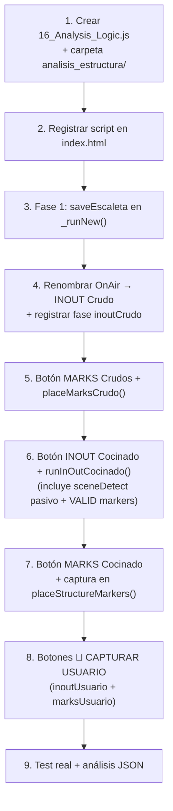

# Plan: Sistema de Depuración y Análisis de Marcadores de Ítems

**Versión:** 1.1 — Incorpora clarificaciones del 03/05/2026

---

## 1. Objetivo

Instrumentar el workflow completo de colocación de marcadores para capturar **tres capas de datos** comparables:

| Capa | IN/OUT secuencia | Marcadores de ítems |
|------|-----------------|---------------------|
| **Crudo** | WorkArea calculado desde escaleta | Posición ideal desde lógica aditiva |
| **Cocinado** | WorkArea snapeado a corte real | Posición snapeada a corte real |
| **Usuario** | Marcador movido manualmente a 1s del borde | Marcador movido manualmente |

El archivo JSON de análisis acumula las tres capas para análisis posterior de patrones y outliers.

---

## 2. Aclaraciones Confirmadas

1. **Ruta `analisis_estructura/`** → **raíz del proyecto** (junto a `index.html`, `js/`, etc.)
2. **"Delimitadores de la secuencia"** → son los **Work Area In/Out de Premiere** (no marcadores de color)
3. **SceneDetect (`runScene()`)** → **no se modifica** (solo hace `Clips.scenes()` + `Project.save()`)

---

## 3. Mecanismo de Validación de Usuario (nuevo)

### 3.1 Para IN/OUT (INOUT Cocinado)

Cuando se pulsa **INOUT Cocinado**:
1. Se calculan y colocan los Work Area In/Out snapeados al corte real
2. **Adicionalmente**, se colocan **dos marcadores de validación** en color diferente (ej. naranja, color 3):
   - `VALID_IN` → a **+1s del Work Area In** (1 segundo hacia el interior del clip)
   - `VALID_OUT` → a **-1s del Work Area Out** (1 segundo hacia el interior del clip)
3. El usuario mueve estos marcadores si necesita ajustar la posición real
4. Al leer el JSON de análisis se comparan las tres posiciones: cruda, cocinada y la del usuario

```
WorkAreaIn (cocinado)
    |
    |←— 1s —→| VALID_IN (naranja) ← usuario puede mover esto
              ...contenido del bloque...
                              VALID_OUT (naranja) ← usuario puede mover esto
                              |←— 1s —→|
                                        WorkAreaOut (cocinado)
```

**Guardado en JSON:**
- `inoutCocinado.validInMarker` → posición inicial del marcador VALID_IN
- `inoutCocinado.validOutMarker` → posición inicial del marcador VALID_OUT
- `inoutUsuario` → fase separada que se rellena cuando el usuario pulsa un botón "CAPTURAR USUARIO" (lee la posición actual de los marcadores VALID_IN/VALID_OUT del timeline)

### 3.2 Para marcadores de ítems (MARKS Cocinado)

Cuando se pulsa **MARKS Cocinado**:
1. Se colocan los marcadores snapeados (lógica actual de `placeStructureMarkers`)
2. Cada marcador de ítem estructural lleva también una **referencia de validación** — el propio marcador es editable por el usuario
3. Un botón **"CAPTURAR USUARIO MARKS"** lee las posiciones actuales de todos los marcadores del timeline y las guarda como `marksUsuario`

---

## 4. Esquema JSON Completo (v1.1)

```
analisis_estructura/[DD_MM]_[PROG]_[BLOC].json
```

```jsonc
{
  "meta": {
    "prog": "TN_VESPRE", "bloc": "V1", "data": "03_05",
    "escaletaFile": "TN_VESPRE_20260503_213006.json",
    "generatedAt": "...", "lastUpdatedAt": "...",
    "phases": {
      "escaleta": true,
      "inoutCrudo": true,   "marksCrudo": true,
      "sceneDetect": true,
      "inoutCocinado": true, "marksCocinado": true,
      "inoutUsuario": true,  "marksUsuario": true
    }
  },

  // ── Fase 1: datos de escaleta ─────────────────────────────────
  "escaleta": {
    "itemsBloc": [
      {
        "sequencia": 42, "num": "01", "titol": "PRESENTACIÓ",
        "agrupacio": "V1", "durada": "0:34", "duradaOnAir": "0:33",
        "horaEntradaPrevista": "21:02:00", "horaSortidaPrevista": "21:02:34",
        "horaEntradaOnAir": "21:02:03", "teVideo": false, "flotant": false
      }
    ],
    "itemsContexte": {
      "prevVideoItem": {
        "num": "SV-EDIP", "titol": "SV ÈDIP I ANTÍGONA", "agrupacio": "V0",
        "horaEntradaOnAir": "21:01:30", "duradaOnAir": "0:18"
      },
      "nextVideoItem": {
        "num": "01", "titol": "PRESENTACIÓ V2", "agrupacio": "V2",
        "horaEntradaOnAir": "21:15:00", "duradaOnAir": "0:30"
      }
    },
    "trimBounds": {
      "inPoint": 177.2, "outPoint": 892.5, "duration": 715.3,
      "tierIn": 10, "tierOut": 1,
      "mediaStart": "20:59:00:00", "realStart": 75687.0, "realEnd": 76373.5
    }
  },

  // ── Fase 2: WorkArea calculado desde escaleta ─────────────────
  "inoutCrudo": {
    "workAreaIn": 0.0,
    "workAreaOut": 714.8,
    "capturedAt": "2026-05-03T21:31:00Z"
  },

  // ── Fase 3: marcadores posición ideal (sin snap) ──────────────
  "marksCrudo": {
    "markers": [
      {
        "num": "01", "titol": "PRESENTACIÓ",
        "posIdeal": 0.0, "posColocada": 0.0,
        "categoria": "ESTRUCTURAL", "duradaSec": 34
      }
    ],
    "capturedAt": "2026-05-03T21:32:00Z"
  },

  // ── Fase 4: cortes de SceneDetect ────────────────────────────
  "sceneDetect": {
    "cortes": [0.0, 17.04, 61.48, 75.36, 77.16, 103.60, 120.56],
    "totalClips": 42,
    "capturedAt": "2026-05-03T21:35:00Z"
  },

  // ── Fase 5a: WorkArea snapeado + marcadores de validación ─────
  "inoutCocinado": {
    "workAreaIn": 0.0,
    "workAreaOut": 714.96,
    "snapDeltaIn": 0.0,
    "snapDeltaOut": 0.16,
    // Marcadores de validación colocados a ±1s del borde (color naranja)
    "validInMarker":  1.0,    // workAreaIn + 1s
    "validOutMarker": 713.96, // workAreaOut - 1s
    "capturedAt": "2026-05-03T21:40:00Z"
  },

  // ── Fase 5b: marcadores snapeados ────────────────────────────
  "marksCocinado": {
    "markers": [
      {
        "num": "01", "titol": "PRESENTACIÓ",
        "posIdeal": 0.0, "posColocada": 0.0,
        "corteUsado": 0, "deltaCrudo": 0.0,
        "categoria": "ESTRUCTURAL", "snapApplied": false
      },
      {
        "num": "02", "titol": "SV PRINCIPAL",
        "posIdeal": 34.0, "posColocada": 35.04,
        "corteUsado": 2, "deltaCrudo": 1.04,
        "categoria": "ESTRUCTURAL", "snapApplied": true
      }
    ],
    "capturedAt": "2026-05-03T21:42:00Z"
  },

  // ── Fase 6a: posición IN/OUT ajustada por el usuario ─────────
  // Se rellena al pulsar "CAPTURAR USUARIO" — lee los marcadores
  // VALID_IN / VALID_OUT del timeline en su posición actual
  "inoutUsuario": {
    "validInMarker":  1.5,    // posición real del marcador tras ajuste
    "validOutMarker": 713.20,
    "deltaVsCocinado_in":  0.5,
    "deltaVsCocinado_out": -0.76,
    "capturedAt": "2026-05-03T21:50:00Z"
  },

  // ── Fase 6b: posición de marcadores ajustados por el usuario ─
  // Se rellena al pulsar "CAPTURAR USUARIO MARKS" — lee todos
  // los marcadores del timeline y los mapea por comentario (num)
  "marksUsuario": {
    "markers": [
      {
        "num": "01", "titol": "PRESENTACIÓ",
        "posUsuario": 0.0,
        "deltaVsCocinado": 0.0,
        "deltaVsCrudo": 0.0
      },
      {
        "num": "02", "titol": "SV PRINCIPAL",
        "posUsuario": 36.0,
        "deltaVsCocinado": 0.96,
        "deltaVsCrudo": 2.0
      }
    ],
    "capturedAt": "2026-05-03T21:52:00Z"
  }
}
```

---

## 5. Fases de Implementación

### FASE 1 — Volcado de escaleta (`_runNew()`)

- Llamar `AnalysisLogic.saveEscaleta(ctx, escaletaFile, lines, contextItems, trimBounds)` al final de `_runNew()` en `flow_mainButton.js`
- `lines` = resultado de `reader.getLinesForBlock(data, ctx.bloque)` (ya disponible)
- `contextItems` = extraer de `calcPrecisionTrimBounds` el item previo y siguiente con OnAir
- `trimBounds` = resultado de `calcPrecisionTrimBounds` (ya disponible)

---

### FASE 2 — INOUT Crudo (renombrar "OnAir")

- Cambiar texto del botón `btnSetBlocIn` de **"OnAir"** a **"INOUT Crudo"**
- Añadir al handler existente (buscar `btnSetBlocIn` en `main.js`):
```javascript
const waIn  = await callJSX('Timeline.getWorkAreaIn()');
const waOut = await callJSX('Timeline.getWorkAreaOut()');
await AnalysisLogic.appendPhase(ctx, 'inoutCrudo', {
    workAreaIn: parseFloat(waIn), workAreaOut: parseFloat(waOut),
    capturedAt: new Date().toISOString()
});
```

---

### FASE 3 — Botón "MARKS Crudos" (nuevo)

HTML: `<button id="btnMarksCrudo" class="secondary">MARKS Crudos</button>`

Nueva función `placeMarksCrudo()` en `flow_assembly.js`:
- Misma lógica aditiva que `placeStructureMarkers()` pero **sin `snapToCut`**
- `posColocada = posIdeal` para todos los ítems
- Guarda fase `marksCrudo` en el JSON de análisis

---

### FASE 4 — SceneDetect

**Sin cambios en `runScene()`.**

El registro de cortes se hará de forma pasiva: cuando se pulse INOUT Cocinado o MARKS Cocinado, se leen los clips de V1 en ese momento y se guarda `sceneDetect` si aún no existe en el JSON.

---

### FASE 5a — Botón "INOUT Cocinado" (nuevo)

HTML: `<button id="btnInoutCocinado" class="secondary">INOUT Cocinado</button>`

Nueva función `runInOutCocinado()` en `flow_assembly.js`:

```javascript
runInOutCocinado: async function() {
    const clips  = await getClipsLogic().getTrackClips(1, 'video');
    const cortes = clips.map(c => c.start);

    // Leer WorkArea crudo del JSON (o del timeline actual)
    const ctx = await MainButton._setupContext();
    const analysis = await AnalysisLogic._load(AnalysisLogic._getPath(ctx));
    const waCrudo = analysis.inoutCrudo || {};

    const waInCrudo  = waCrudo.workAreaIn  ?? 0;
    const waOutCrudo = waCrudo.workAreaOut ?? clips[clips.length-1]?.end ?? 0;

    // Snap a corte más cercano
    const snapIn  = this._snapSimple(waInCrudo, cortes);
    const snapOut = this._snapSimple(waOutCrudo, cortes);

    // Aplicar WorkArea en Premiere
    await callJSX(`Timeline.setWorkArea(${snapIn}, ${snapOut})`);

    // Colocar marcadores de validación a ±1s (color naranja = 3)
    const validIn  = snapIn  + 1.0;
    const validOut = snapOut - 1.0;
    await callJSX(`Markers.set(${validIn},  'VALID_IN',  'color=3')`);
    await callJSX(`Markers.set(${validOut}, 'VALID_OUT', 'color=3')`);

    // Guardar fase sceneDetect si no existe
    if (!analysis.sceneDetect) {
        await AnalysisLogic.appendPhase(ctx, 'sceneDetect', {
            cortes, totalClips: clips.length,
            capturedAt: new Date().toISOString()
        });
    }

    // Guardar fase inoutCocinado
    await AnalysisLogic.appendPhase(ctx, 'inoutCocinado', {
        workAreaIn: snapIn, workAreaOut: snapOut,
        snapDeltaIn:  snapIn  - waInCrudo,
        snapDeltaOut: snapOut - waOutCrudo,
        validInMarker: validIn, validOutMarker: validOut,
        capturedAt: new Date().toISOString()
    });
},

// Helper: snap al corte más cercano dentro de 2s de tolerancia
_snapSimple: function(pos, cortes) {
    let best = pos, minD = Infinity;
    for (const c of cortes) {
        const d = Math.abs(c - pos);
        if (d < minD && d <= 2.0) { minD = d; best = c; }
    }
    return best;
}
```

---

### FASE 5b — Botón "MARKS Cocinado" (nuevo)

HTML: `<button id="btnMarksCocinado" class="secondary">MARKS Cocinado</button>`

- Llama a `placeStructureMarkers()` tal como está (con `snapToCut`)
- `placeStructureMarkers()` se modifica para **retornar** el array de resultados
- Se guarda `sceneDetect` pasivamente si no existe
- Se guarda la fase `marksCocinado` con `deltaCrudo` calculado comparando con `marksCrudo`

---

### FASE 6a — Botón "CAPTURAR USUARIO" (nuevo, pequeño)

HTML: `<button id="btnCapturaUsuarioInOut" class="secondary btn-sq-std" title="Capturar posición de marcadores VALID_IN/OUT">📍</button>` junto a "INOUT Cocinado"

Lee los marcadores del timeline con comentario `VALID_IN` y `VALID_OUT` y guarda `inoutUsuario`.

---

### FASE 6b — Botón "CAPTURAR USUARIO MARKS" (nuevo, pequeño)

HTML: `<button id="btnCapturaUsuarioMarks" class="secondary btn-sq-std" title="Capturar posición actual de marcadores de ítems">📍</button>` junto a "MARKS Cocinado"

Lee todos los marcadores del timeline, los mapea por `num` (extraído del comentario), y guarda `marksUsuario` calculando `deltaVsCocinado` y `deltaVsCrudo`.

---

## 6. Módulo `js/logic/16_Analysis_Logic.js`

```javascript
(function () {
    var FASTPASS_UI = window.FASTPASS_UI || {};
    FASTPASS_UI.Logic = FASTPASS_UI.Logic || {};

    const callJSX = (s) => window.FASTPASS_UI.Utils.callJSX(s);
    const log = (m) => window.FASTPASS_UI.Utils.log(m, 'DEBUG');

    FASTPASS_UI.Logic.Analysis = {

        _getPath(ctx) {
            const dd_mm = ctx.dateDir.substring(0, 5);
            return `analisis_estructura/${dd_mm}_${ctx.progData.archivo}_${ctx.bloque}.json`;
        },

        async _load(path) {
            const raw = await callJSX(`IO.readTxt('${path}')`);
            if (!raw || raw.startsWith('ERR') || raw === '') return {};
            try { return JSON.parse(raw); } catch (e) { return {}; }
        },

        async _save(path, data) {
            const json    = JSON.stringify(data, null, 2);
            const escaped = json.replace(/\\/g, '\\\\').replace(/'/g, "\\'");
            await callJSX(`IO.writeTxt('${path}', '${escaped}')`);
        },

        async saveEscaleta(ctx, escaletaFile, lines, contextItems, trimBounds) {
            const path = this._getPath(ctx);
            const ex   = await this._load(path);
            const now  = new Date().toISOString();
            await this._save(path, {
                ...ex,
                meta: {
                    ...(ex.meta||{}), prog: ctx.progData.archivo,
                    bloc: ctx.bloque, data: ctx.dateDir.substring(0,5),
                    escaletaFile, generatedAt: ex.meta?.generatedAt||now,
                    lastUpdatedAt: now,
                    phases: { ...(ex.meta?.phases||{}), escaleta: true }
                },
                escaleta: {
                    itemsBloc: lines.map(l => ({
                        sequencia: l.sequencia, num: l.num||'',
                        titol: l.titol||'', agrupacio: l.agrupacio||null,
                        durada: l.durada||'0:00', duradaOnAir: l.duradaOnAir||null,
                        horaEntradaPrevista: l.horaEntradaPrevista||null,
                        horaSortidaPrevista: l.horaSortidaPrevista||null,
                        horaEntradaOnAir: l.horaEntradaOnAir||null,
                        teVideo: l.teVideo||false, flotant: l.flotant||false
                    })),
                    itemsContexte: contextItems||{},
                    trimBounds: trimBounds||null
                }
            });
            log(`📊 [Analysis] escaleta → ${path}`);
        },

        async appendPhase(ctx, phaseName, phaseData) {
            const path = this._getPath(ctx);
            const ex   = await this._load(path);
            const now  = new Date().toISOString();
            await this._save(path, {
                ...ex,
                meta: {
                    ...(ex.meta||{}), lastUpdatedAt: now,
                    phases: { ...(ex.meta?.phases||{}), [phaseName]: true }
                },
                [phaseName]: phaseData
            });
            log(`📊 [Analysis] ${phaseName} → ${path}`);
        }
    };

    window.FASTPASS_UI.Logic.Analysis = FASTPASS_UI.Logic.Analysis;
})();
```

---

## 7. Mapa de Cambios por Archivo

| Archivo | Cambio | Descripción |
|---------|--------|-------------|
| `js/logic/16_Analysis_Logic.js` | **NUEVO** | Módulo de análisis |
| `analisis_estructura/` | **NUEVO** (carpeta) | Raíz del proyecto |
| `index.html` | **MODIFICAR** | Renombrar "OnAir"→"INOUT Crudo"; +5 botones nuevos |
| `js/main.js` | **MODIFICAR** | Listeners para los 5 botones nuevos |
| `js/workflows/flow_mainButton.js` | **MODIFICAR** | `saveEscaleta()` en `_runNew()` |
| `js/workflows/flow_assembly.js` | **MODIFICAR** | INOUT Crudo + `placeMarksCrudo()` + `runInOutCocinado()` + captura en `placeStructureMarkers()` + captura usuario |

---

## 8. UI — Sección GRÀFICS (disposición propuesta)

```
[RESET] [RETOLS ___]
[INOUT Crudo] [INOUT Cocinado] [📍]
[MARKS Crudos] [MARKS Cocinado] [📍]
[ESTRUCTURA] [O] [GRAFIC] [16:9] [FONS]
```

Los botones 📍 ("capturar usuario") son pequeños `btn-sq-std` para no ocupar demasiado espacio.

> [!TIP]
> Alternativa: agrupar las dos filas de análisis bajo un toggle "🔍 DEBUG" si la UI queda sobrecargada.

---

## 9. Guía de Análisis Posterior

### Tres deltas a comparar para IN/OUT

| Comparación | Campo JSON | Significado |
|------------|-----------|-------------|
| Cocinado − Crudo | `snapDeltaIn/Out` | Efecto del snap |
| Usuario − Cocinado | `deltaVsCocinado_in/out` | Corrección manual del snap |
| Usuario − Crudo | calculado | Error total del sistema |

### Tres deltas para marcadores de ítems

| Comparación | Campo JSON | Significado |
|------------|-----------|-------------|
| Cocinado − Crudo | `deltaCrudo` en `marksCocinado` | Efecto del snap |
| Usuario − Cocinado | `deltaVsCocinado` en `marksUsuario` | Corrección manual |
| Usuario − Crudo | `deltaVsCrudo` en `marksUsuario` | Error total |

### Patrones a buscar
- **Offset sistemático** en `deltaCrudo`: el cálculo aditivo tiene un sesgo constante
- **`snapApplied: false`** con `deltaVsCocinado > 0.5s`: el usuario corrigió un snap que parecía correcto
- **Correlación categoría ↔ delta**: ¿LARGO se snap mejor que MEDIO?
- **Correlación blocIn delta ↔ marks delta**: si el IN está mal, ¿los marcadores también se desplazan todos uniformemente?

---

## 10. Orden de Implementación


