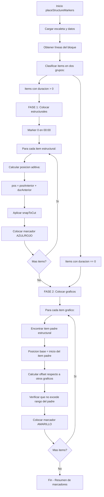

# Plan: Refactorización de `placeStructureMarkers` — Algoritmo de Dos Fases

## Resumen del Problema

Actualmente [`placeStructureMarkers()`](js/workflows/flow_assembly.js:790) procesa todos los ítems (estructurales + gráficos) en un **único bucle**, con dos mecanismos de posicionamiento que compiten:

1. **Mecanismo aditivo** (línea [`1210`](js/workflows/flow_assembly.js:1210)): `currentTime += duradaSec`
2. **Mecanismo por timestamp** (línea [`1081`](js/workflows/flow_assembly.js:1081)): recalcula desde timecode absoluto

Además, [`snapToCut()`](js/workflows/flow_assembly.js:1017) busca el primer clip del timeline con duración suficiente, lo que desplazó el primer marcador a ~34s.

El fix actual (forzar primer marcador a 00:00 con `placedMarkers.length === 0`) es un parche que no resuelve el problema de fondo: el algoritmo debe ser de **dos fases**.

## Algoritmo Correcto (Confirmado por el Usuario)

### Fase 1 — Marcadores Estructurales (AZUL + ROJO)

**Qué items**: Aquellos con `durada > 0` (independientemente de `agrupacio`).
- Con `agrupacio` → AZUL (6)
- Sin `agrupacio` (ROJO) → también se colocan en Fase 1, pero se marcan en rojo para edición posterior

**Algoritmo de posicionamiento**:
1. **Marker 0**: Posición `00:00` — forzado, sin ningún tipo de lógica
2. **Marker N**: `posición = posición_marker_N-1 + duración_item_N-1`
3. **Snap**: Al resultado se le aplica `snapToCut()` para encontrar el frame exacto de transición entre clips (porque la información de la escaleta no es exacta al frame)

**No se usa**: El cálculo basado en `horaEntradaOnAir` o `horaEntradaPrevista` para posicionar. Solo se usa la duración de cada item para el cálculo aditivo.

### Fase 2 — Marcadores Gráficos (AMARILLO / GRAFISMOS)

**Qué items**: Aquellos con `durada === 0` (independientemente de `agrupacio`).
- Si tienen `agrupacio` pero duración 0 → son clips GRÁFICOS (amarillos)
- Si no tienen `agrupacio` y duración 0 → GRAFISMOS (amarillos)

**Algoritmo de posicionamiento**:
1. Se colocan **después** de todos los estructurales
2. Cada marcador gráfico va **dentro de su item padre** (después del marker estructural que marca el comienzo del ítem)
3. **Offset ideal**: 4 segundos de separación entre marcadores gráficos para que no queden superpuestos y se puedan identificar/mover
4. **Limitación**: Si el item padre es más corto, la separación debe calcularse para que los gráficos no se salgan del rango del item padre (no sobrepasar el siguiente marcador estructural)
5. **NO se aplica** `snapToCut` a los gráficos

---

## Diagrama de Flujo del Nuevo Algoritmo



---

## Cambios Necesarios en el Código

### 1. Nueva función de clasificación

Crear una función que clasifique cada item en dos categorías:

```javascript
const esItemEstructural = (line) => {
    const dStr = line.durada || line.duradaOnAir || '0:00';
    const dSec = parseDurada(dStr);
    return dSec > 0;
};

const esItemGrafico = (line) => {
    const dStr = line.durada || line.duradaOnAir || '0:00';
    const dSec = parseDurada(dStr);
    return dSec === 0;
};
```

### 2. Refactorizar el bucle principal (Fase 1)

Reemplazar el bucle único actual (líneas [`1073`](js/workflows/flow_assembly.js:1073)-[`1212`](js/workflows/flow_assembly.js:1212)) con:

```javascript
// ============================================================
// FASE 1: M Arcadores Estructurales (duracion > 0)
// ============================================================
// Posicion base inicial: 00:00
let currentStructuralPos = 0;
let ultimoCorteUsadoEstructural = -1;

for (const line of structuralItems) {
    const categoria = clasificarItem(line); // LARGO, MEDIO, CORTO, NO_VERTICALIZABLE
    const dStr = line.durada || line.duradaOnAir || '0:00';
    const dSec = parseDurada(dStr);
    
    // Primer marcador: forzar 00:00
    let posIdeal;
    if (placedMarkers.length === 0) {
        posIdeal = 0;
    } else {
        posIdeal = currentStructuralPos;
    }
    
    // Aplicar snap a cortes
    const resultado = snapToCut(posIdeal, categoria, cortes, clips, ultimoCorteUsadoEstructural);
    const posicionFinal = resultado.corte;
    ultimoCorteUsadoEstructural = resultado.idx;
    
    // Colocar marcador
    const colorIdx = line.agrupacio ? 6 : 1; // AZUL o ROJO
    await callJSX(script);
    placedMarkers.push(posicionFinal);
    
    // Avanzar posicion acumulada para el siguiente item estructural
    currentStructuralPos += dSec;
}
```

### 3. Segundo bucle (Fase 2)

```javascript
// ============================================================
// FASE 2: Marcadores Gráficos (duracion == 0)
// ============================================================
// Despues de colocar todos los estructurales

for (const line of graphicItems) {
    const categoria = 'GRAFISMO';
    const dStr = line.durada || line.duradaOnAir || '0:00';
    const dSec = parseDurada(dStr); // siempre 0
    
    // Encontrar el marcador estructural que le precede (item padre)
    const parentMarkerPos = encontrarItemPadre(line, placedMarkers, structuralItems);
    
    // Posicion base: inicio del item padre
    const posBase = parentMarkerPos;
    
    // Calcular offset: 4s ideal, pero limitado por el siguiente estructural
    const siguienteEstructural = encontrarSiguienteEstructural(line, structuralItems, placedMarkers);
    const limiteSuperior = siguienteEstructural || (posBase + 10); // seguro
    
    // Buscar espacio libre desde posBase+4 hacia atras o ajustar
    let posicionFinal = buscarEspacioLibre(posBase, placedMarkers, 4.0, limiteSuperior);
    
    // NO se aplica snapToCut
    await callJSX(script);
    placedMarkers.push(posicionFinal);
}
```

### 4. Función auxiliar: `encontrarItemPadre()`

Dado un item gráfico (p.ej. `01QR`, `01lin`), encontrar el marcador estructural que lo contiene basándose en:
- `extractBlockId(line.num)` — p.ej. `01QR` → `01`, pertenece al bloque del item `01lead`
- O el orden secuencial: el item gráfico está entre el item estructural anterior y el siguiente

### 5. Función auxiliar: `buscarEspacioLibre()`

Dada una posición base (inicio del item padre), colocar marcadores gráficos con offset de 4s, pero:
- Si hay otros marcadores gráficos ya colocados, separarlos 4s
- No sobrepasar el `limiteSuperior` (inicio del siguiente item estructural)

### 6. Eliminar lógica obsoleta

- Eliminar el cálculo de `currentTime` basado en `lineSec - minLineSec` (línea [`1081`](js/workflows/flow_assembly.js:1081)) — ahora irrelevante
- Eliminar `bloqueMap` y `mainItemPosMap` — la herencia del clip se simplifica
- Eliminar la deduplicación de GRAFISMOS actual (líneas [`1142`](js/workflows/flow_assembly.js:1142)-[`1178`](js/workflows/flow_assembly.js:1178)) — reemplazada por la nueva lógica de Fase 2
- Eliminar la clasificación `clasificarItem` actual — reemplazada por la clasificación simple duración > 0 / duración == 0

---

## Ejemplo con Datos Reales (V1)

### Items del bloque V1 en la escaleta

| num | durada | agrupacio | Tipo | Fase | Color |
|-----|--------|-----------|------|------|-------|
| 01QR | 0:00 | null | GRAFISMO | Fase 2 | AMARILLO |
| 01lead | 0:40 | v1 | LARGO | Fase 1 | AZUL |
| 01lin | 0:00 | v1 | gráfico | Fase 2 | AMARILLO |
| 01chy | 0:00 | v1 | gráfico | Fase 2 | AMARILLO |
| 01gf1 | 0:00 | v1 | gráfico | Fase 2 | AMARILLO |
| 01te | 0:00 | v1 | gráfico | Fase 2 | AMARILLO |
| 01gf2 | 0:00 | v1 | gráfico | Fase 2 | AMARILLO |
| 01dp | 0:19 | v1 | MEDIO | Fase 1 | AZUL |
| 01dir | 0:45 | v1 | LARGO | Fase 1 | AZUL |
| 01 | 0:00* | v1 | gráfico? | Fase 2? | AMARILLO? |
| 02 | 1:55 | v1 | LARGO | Fase 1 | AZUL |

*\*Item `01` tiene `durada="0:00"` pero `duradaOnAir="0:33"`. Pendiente de determinar si se considera estructural por `duradaOnAir`.*

### Posiciones esperadas (Fase 1, asumiendo snap perfecto)

| Item | Cálculo aditivo | Posición ideal | Posición tras snap |
|------|-----------------|----------------|--------------------|
| 01lead | 00:00 | 00:00 | 00:00 (forzado) |
| 01dp | 00:00 + 0:40 = 40s | 00:40 | ~00:40 (snap) |
| 01dir | 40s + 0:19 = 59s | 00:59 | ~00:59 (snap) |
| 02 | 59s + 0:45 = 104s | 01:44 | ~01:44 (snap) |

### Posiciones esperadas (Fase 2)

| Item | Item padre | Offset ideal | Rango válido |
|------|-----------|-------------|--------------|
| 01QR | 01lead | padre + 0s - separación | [0, 40) |
| 01lin | 01lead | padre + 4s | [4, 40) |
| 01chy | 01lead | padre + 8s | [8, 40) |
| 01gf1 | 01lead | padre + 12s | [12, 40) |
| 01te | 01lead | padre + 16s | [16, 40) |
| 01gf2 | 01lead | padre + 20s | [20, 40) |

---

## Riesgos y Consideraciones

1. **Item `01` con `durada="0:00"` y `duradaOnAir="0:33"`**: La función `parseDurada` usa `line.durada || line.duradaOnAir`. Si `durada` es "0:00" y `duradaOnAir` es "0:33", debería usar "0:33". Pero la función actual usa `||`, donde "0:00" es truthy (es un string), así que tomaría "0:00". **Hay que corregir**: usar `duradaOnAir` si `durada` es "0:00" o null/undefined.

2. **Items sin `num`**: Algunos items de la escaleta pueden no tener `num`. La función `extractBlockId` devuelve `''` en ese caso. La asignación al item padre debe considerar también el orden secuencial.

3. **Items GRAFISMO sin `agrupacio` ni `num`**: Estos items (como `01QR`) no tienen bloque padre claro. Deben posicionarse en el contexto del item estructural más cercano que los precede.

4. **Rendimiento**: La Fase 2 necesita buscar espacio libre entre marcadores ya colocados. Con pocos items (máximo ~20 por bloque), no debería ser un problema.

---

## Archivos a Modificar

- **Principal**: [`js/workflows/flow_assembly.js`](js/workflows/flow_assembly.js) — función `placeStructureMarkers()` (~líneas 790-1250)
- **Posiblemente**: [`js/core/escaleta_reader.js`](js/core/escaleta_reader.js) — si se necesita mejorar `getLinesForBlock` o `getBlockItems`
- **Pruebas**: Datos en [`TN_VESPRE_20260423_213005.json`](TN_VESPRE_20260423_213005.json) — ya disponible

---

## Orden de Implementación

1. **Paso 1**: Separar items en dos listas (estructurales vs gráficos) basándose en `durada > 0`
2. **Paso 2**: Implementar Fase 1 (bucle de estructurales con snap)
3. **Paso 3**: Implementar Fase 2 (bucle de gráficos con offset)
4. **Paso 4**: Eliminar código obsoleto (bloqueMap, mainItemPosMap, deduplicación antigua)
5. **Paso 5**: Probar con el JSON `TN_VESPRE_20260423_213005.json` y verificar logs
