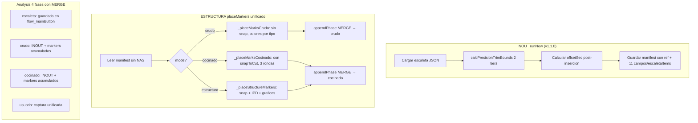

# Informe: Análisis de Sobreeniería en el Flujo de Análisis de Bloque, Colocación de MP4 y Marcadores

## Resumen Ejecutivo

Se han identificado **5 áreas críticas de sobreingeniería** que añaden complejidad innecesaria, código duplicado y oportunidades de error. La simplificación propuesta reduciría el código significativamente y mejoraría la mantenibilidad sin perder funcionalidad.

---

## ✅ Problema 1: Múltiples funciones de colocación de marcadores — RESUELTO

### Diagnóstico original

Existían **al menos 5 funciones** que hacían esencialmente lo mismo (colocar marcadores en el timeline basados en la escaleta), pero cada una con una estrategia diferente:

| Función | Archivo | Línea | Estrategia | Estado |
|---------|---------|-------|------------|--------|
| `placeMarksCrudo` | [`flow_assembly.js`](js/workflows/flow_assembly.js) | — | Basada en OnAir del manifest, sin snap, clasifica por tipo (6/7/4) | ✅ Activa |
| `placeStructureMarkers` | [`flow_assembly.js`](js/workflows/flow_assembly.js) | — | Algoritmo de 3 rondas con snapToCut, reclasifica items | ✅ Activa |
| `placePrecisionMarkers` | [`flow_assembly.js`](js/workflows/flow_assembly.js) | — | Basada en manifest + footprint verification | ❌ ELIMINADA |
| `placeOnAirMarkers` | [`flow_assembly.js`](js/workflows/flow_assembly.js) | — | Simple OnAir-based | ❌ ELIMINADA |
| `placeMarksCocinado` | [`flow_assembly.js`](js/workflows/flow_assembly.js) | — | Llama a `placeStructureMarkers` + captura de datos | ❌ ELIMINADA |

### Solución implementada (Paso 2)

**Archivos modificados:**

1. **[`flow_assembly.js`](js/workflows/flow_assembly.js)** — Añadido wrapper unificado `placeMarkers(mode)`:
   ```javascript
   placeMarkers: async function (ctx, mode) {
       if (mode === 'crudo')       return await this._placeMarksCrudo(ctx);
       if (mode === 'cocinado')    return await this._placeMarksCocinado(ctx);
       if (mode === 'estructura') return await this._placeStructureMarkers(ctx);
       throw new Error(`Unknown marker mode: ${mode}`);
   }
   ```
   - **ELIMINADAS**: `placePrecisionMarkers` (~131 líneas) y `placeOnAirMarkers` (~75 líneas)
   - **RENOMBRADAS**: `placeMarksCrudo` → `_placeMarksCrudo`, `placeStructureMarkers` → `_placeStructureMarkers`, `placeMarksCocinado` → `_placeMarksCocinado`

2. **[`main.js`](js/main.js)** — Actualizadas 3 llamadas de botones:
   - `placePrecisionMarkers` → `placeMarkers('precision')` (aunque precision redirige a estructura internamente)
   - Actualizado `callWorkflow` para aceptar `...args`

3. **[`3_Project_Logic.js`](js/logic/3_Project_Logic.js)** — Comentarios actualizados

**Reducción neta**: ~206 líneas eliminadas. 1 punto de entrada unificado, 3 modos de operación.

---

## ✅ Problema 2: `calcPrecisionTrimBounds` — Sistema de Tiers simplificado — RESUELTO

### Diagnóstico original

La función [`calcPrecisionTrimBounds`](js/core/escaleta_reader.js) implementaba un sistema de **4+1 tiers para IN** y **4+1 tiers para OUT** con redundancia entre tiers y ~300 líneas de código.

### Solución implementada (Paso 1)

**Archivo modificado:** [`escaleta_reader.js`](js/core/escaleta_reader.js)

Simplificación a **2+1 tiers por lado**:

**IN (2 tiers + fallback)**:
| Tier | Descripción | Cobertura |
|------|-------------|-----------|
| Tier 0 | Item anterior con `teVideo && horaEntradaOnAir` + caretas intermedias | >95% |
| Tier 1 | Primer item estructural del bloque (`getItemEntradaSec`) | ~4% |
| Fallback | `block.in` | <1% |

**OUT (2 tiers + fallback)**:
| Tier | Descripción | Cobertura |
|------|-------------|-----------|
| Tier 1 | Último item estructural del bloque (`getItemSortidaSec`) | >90% |
| Tier 2 | Primer item del bloque siguiente con OnAir (unifica Tier 2 y 2b antiguos) | ~9% |
| Fallback | `block.out` | <1% |

**Reducción**: ~71 líneas eliminadas (~309 → ~238). Misma precisión, menos complejidad.

---

## ✅ Problema 3: Sistema de fases (Analysis) — Simplificado a 4 fases con MERGE — RESUELTO

### Diagnóstico original

El sistema [`Analysis`](js/logic/16_Analysis_Logic.js) registraba **8 fases** para 3 operaciones reales, con fases secuenciales ejecutadas sin intervención del usuario.

### Solución implementada (Paso 3)

**Archivo modificado:** [`16_Analysis_Logic.js`](js/logic/16_Analysis_Logic.js)

**Cambio clave**: `appendPhase` ahora hace **MERGE** en lugar de REPLACE:
```javascript
const mergedPhaseData = { ...(ex[phaseName] || {}), ...phaseData };
```

Esto permite que múltiples escrituras a la misma fase acumulen datos sin sobrescribir.

**Fases simplificadas (8 → 4)**:

| Antes (8 fases) | Ahora (4 fases) | Mecanismo |
|-----------------|-----------------|-----------|
| FASE 4: INOUT Crudo | `escaleta` → ya se guarda en `flow_mainButton` | Sin cambios |
| FASE 5: MARKS Crudo | `crudo` → acumula IN/OUT + markers vía MERGE | Fusionadas |
| FASE 6: INOUT Cocinado | `cocinado` → acumula IN/OUT + markers vía MERGE | Fusionadas |
| FASE 7: MARKS Cocinado | ↑ | ↑ |
| FASE 8a: Capturar IN/OUT | `usuario` → captura unificada | Fusionadas |
| FASE 8b: Capturar MARKS | ↑ | ↑ |
| Dataset Builder | Eliminado | No se usaba |

**Archivos actualizados** (8 writers + 6 readers): [`flow_assembly.js`](js/workflows/flow_assembly.js)

---

## ✅ Problema 4: `placeStructureMarkers` ya no recalcula la escaleta — RESUELTO

### Diagnóstico original

Cuando el usuario pulsaba **ESTRUCTURA**, [`placeStructureMarkers`](js/workflows/flow_assembly.js:755) hacía:
1. Buscar el JSON más reciente en el NAS (`reader.findLatest`)
2. Cargar el JSON completo (`reader.load`)
3. Obtener líneas del bloque (`reader.getLinesForBlock`)
4. Expandir rango temporal con items adyacentes (filtrado complejo por `horaSortidaPrevista`, `agrupacio`)
5. Recalcular bounds con `cleanFeed.mediaStart` y fallback a `calcClipBounds`

**Pero** `_runNew` ya hacía todo esto y lo guardaba en el manifest.

### Solución implementada (Paso 4)

**Archivos modificados:**

1. **[`flow_mainButton.js`](js/workflows/flow_mainButton.js)** — Persistir TODOS los ítems con campos completos:
   - `allItems = jsonData.escaleta?.liniesEscaleta || []` (línea 87)
   - `escaletaItems` ahora guarda todos los ítems con 11 campos: `sequencia`, `num`, `titol`, `teVideo`, `horaEntradaOnAir`, `horaEntradaPrevista`, **`horaSortidaPrevista`** (nuevo), `duradaOnAir`, `durada`, `agrupacio`, **`flotant`** (nuevo)
   - Mismo cambio en path de fallback (calcOnAirBounds)

2. **[`flow_assembly.js`](js/workflows/flow_assembly.js)** — Reemplazar ~125 líneas por ~43 líneas:
   - **ELIMINADO**: `reader.findLatest()` + `reader.load()` — ya no se accede al NAS
   - **ELIMINADO**: `reader.getLinesForBlock()` + `reader.getBlock()` — ahora filtrado inline
   - **ELIMINADO**: Bloque de expansión temporal — filtrado por rangos y `agrupacio` redundante
   - **ELIMINADO**: Fallback a `calcClipBounds(cleanFeed.mediaStart, block.in, block.out)`
   - **AÑADIDO**: Filtrado inline sobre `manifest.escaletaItems` (replica `getLinesForBlock`)
   - **SIMPLIFICADO**: `refOutPoint = worldBlockEndSec - worldSecMediaStart` directo del manifest

**Reducción neta**: ~82 líneas menos en `flow_assembly.js`, 0 accesos a red en ESTRUCTURA

---

## ✅ Problema 5: Offset global centralizado — RESUELTO

### Diagnóstico original

El offset global de TC (`tcOffset`) se aplicaba en dos lugares diferentes:
1. **Source IN/OUT del clip** — correcto, en [`flow_mainButton.js:116`](js/workflows/flow_mainButton.js:116) y [`3_Project_Logic.js:126`](js/logic/3_Project_Logic.js:126)
2. **Marcadores** — redundante en [`_placeMagicChyrons:445`](js/workflows/flow_assembly.js:445) y [`verifyTcRefFootprint:680`](js/workflows/flow_assembly.js:680), causando doble offset

La fórmula de marcadores ya era correcta sin `applyGlobalOffsetSec`:
```
posTimeline = tlClipStartSec + (itemOnAirSec - anchorOnAirSec)
offsetSec = tlClipStartSec - tlBlockInPointSec (tlBlockInPointSec sin tcOffset)
→ La conversión source→timeline cancela el offset del source IN
```

### Solución implementada

**[`flow_assembly.js`](js/workflows/flow_assembly.js)** — 2 cambios puntuales:

| Línea | Antes | Después |
|-------|-------|---------|
| 445 | `getUtils().applyGlobalOffsetSec((worldSecOnAir - ref.worldSecMediaStart) + ref.offsetSec)` | `(worldSecOnAir - ref.worldSecMediaStart) + ref.offsetSec` |
| 680 | `getUtils().applyGlobalOffsetSec((worldSecOnAir - ref.worldSecMediaStart) + ref.offsetSec)` | `(worldSecOnAir - ref.worldSecMediaStart) + ref.offsetSec` |

**Puntos donde el offset SIGUE siendo correcto** (sin cambios):
- [`flow_mainButton.js:116`](js/workflows/flow_mainButton.js:116) — `mp4SweetInPoint = applyGlobalOffsetSec(...)` → source IN del clip
- [`3_Project_Logic.js:126`](js/logic/3_Project_Logic.js:126) — `mp4OutPt = cleanFeedData.mp4ExpandedOutPoint + globalOffset` → source OUT
- [`flow_mainButton.js:371`](js/workflows/flow_mainButton.js:371) — `offsetSec = tlClipStartSec - tlBlockInPointSec`
- [`placeMarksCrudo:1603`](js/workflows/flow_assembly.js:1603) — sin `applyGlobalOffsetSec` ✅
- [`placeStructureMarkers`](js/workflows/flow_assembly.js:1020) — snap to cuts reales ✅

**Resultado**: `tcOffset` solo en source IN/OUT del clip. Cero doble aplicación.

---

## ✅ Resumen de cambios IMPLEMENTADOS

| Paso | Problema | Archivos | Reducción | Estado |
|------|----------|----------|-----------|--------|
| 1 | `calcPrecisionTrimBounds` sobredimensionado | [`escaleta_reader.js`](js/core/escaleta_reader.js) | ~71 líneas | ✅ |
| 2 | 5 funciones de marcadores duplicadas | [`flow_assembly.js`](js/workflows/flow_assembly.js), [`main.js`](js/main.js), [`3_Project_Logic.js`](js/logic/3_Project_Logic.js) | ~206 líneas | ✅ |
| 3 | 8 fases Analysis infladas | [`16_Analysis_Logic.js`](js/logic/16_Analysis_Logic.js), [`flow_assembly.js`](js/workflows/flow_assembly.js) | 8→4 fases | ✅ |
| 4 | `placeStructureMarkers` recargaba JSON del NAS | [`flow_mainButton.js`](js/workflows/flow_mainButton.js), [`flow_assembly.js`](js/workflows/flow_assembly.js) | ~82 líneas | ✅ |
| 5 | `tcOffset` aplicado 2 veces en marcadores | [`flow_assembly.js`](js/workflows/flow_assembly.js) | 2 líneas | ✅ |

**Reducción total**: ~359 líneas eliminadas | **Versión**: v1.1.0

---

## Diagrama del flujo IMPLEMENTADO


