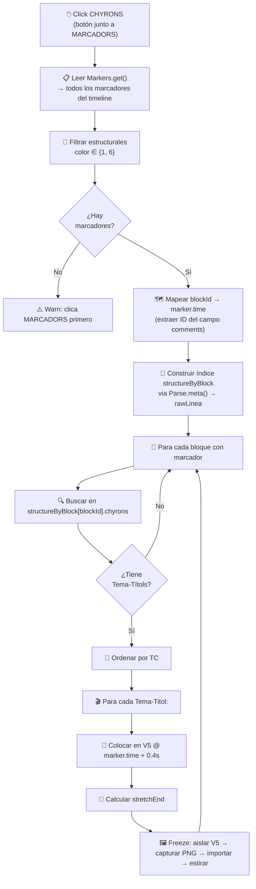
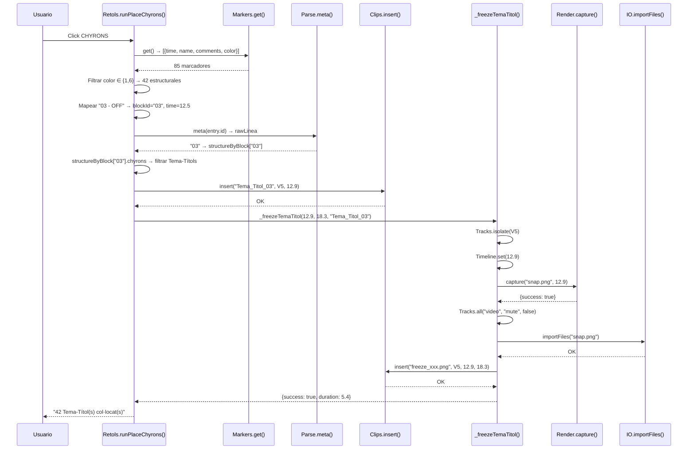

# 📋 PLAN DE COLOCACIÓN DE CHYRONS — v1.0 "TEMA-TITOL"

> **Estado**: ✅ IMPLEMENTADO — 2026-05-15
> **Fase actual**: Tema-Titol (V5) via marcadores + freeze-frame
> **Próximas fases**: NOMCARREC, FIRMA, LLOCDATA, TRADUCCIONS

---

## 🎯 OBJETIVO

Mecanismo guiado por marcadores de timeline para la colocación de chyrons (rótulos gráficos del bin CHY). Primera fase: **Tema-Titol** en pista V5.

## 🧬 ARQUITECTURA DE FUSIÓN

Se fusionan **dos mecánicas preexistentes** sin eliminar código:

| Mecánica | Origen | Qué aporta |
|----------|--------|------------|
| `Retols.runPlaceChyrons()` (original) | [`flow_retols.js:47`](../../js/workflows/flow_retols.js:47) | Iteración CTI-based sobre `state.structure[]`, colocación en V5/V6/V7 |
| `Assembly._placeMagicChyrons()` | [`flow_assembly.js:425`](../../js/workflows/flow_assembly.js:425) | Clasificación de chyrons, timing de precisión, freeze-frame |
| `Assembly.Logic.freeze()` | [`14_Assembly_Logic.js:53`](../../js/logic/14_Assembly_Logic.js:53) | Captura PNG de V5, importación y estiramiento |

## 🔄 FLUJO DEL BOTÓN "CHYRONS"



### Diagrama de secuencia para un Tema-Titol



---

## 📁 CAMBIOS REALIZADOS

### C1: [`index.html`](../../index.html:95) — Botón CHYRONS activado

```html
<div class="graphics-strip">
    <button id="btnMarcadors" class="secondary btn-big-sq">MARCADORS</button>
    <div class="retols-group">
        <button id="btnPlaceChyrons" class="secondary">CHYRONS</button>
        <input type="text" id="txt-retol-part" placeholder="..." readonly>
    </div>
    <!-- Botons ocults de moment: ... -->
</div>
```

El botón `btnPlaceChyrons` y el input `txt-retol-part` estaban comentados dentro de `<!-- Botons ocults de moment: -->`. Se han extraído fuera del comentario y colocados inmediatamente después de `btnMarcadors`. El texto del botón cambió de "RETOLS" a "CHYRONS" para mayor claridad semántica.

### C2: [`flow_retols.js`](../../js/workflows/flow_retols.js:58) — `runPlaceChyrons()` refactorizado

La función original (CTI-based, chunk-by-chunk) se ha reemplazado por una versión marker-guided que:

1. **Lee marcadores del timeline** via [`Markers.get()`](../../jsx/modules/8_Markers.jsx:22) — respeta modificaciones del usuario
2. **Filtra estructurales** por color (1 = rojo, 6 = faro-end)
3. **Extrae `blockId`** del campo `comments` (formato: `"ID - TIPO"`)
4. **Construye índice** `structureByBlock` usando [`Parse.meta()`](../../js/logic/13_Parse.js:140) para extraer `rawLinea`
5. **Itera Tema-Títols** de cada bloque, ordenados por TC
6. **Coloca en V5** a `marker.time + 0.4s` (≈frame 10)
7. **Calcula `stretchEnd`**: último TemaTitol → marcador siguiente; intermedio → offset del siguiente TemaTitol
8. **Delega freeze** en `_freezeTemaTitol()`

#### Nueva función auxiliar: `_freezeTemaTitol()`

```javascript
_freezeTemaTitol: async function (captureTime, stretchEnd, label) {
    // 1. Aísla V5
    // 2. Posiciona cabezal en captureTime
    // 3. Captura PNG via Render.capture()
    // 4. Restaura todas las pistas
    // 5. Importa PNG via IO.importFiles()
    // 6. Calcula duración: stretchEnd - captureTime (o timelineEnd)
    // 7. Inserta freeze-frame en V5 con duración
}
```

### C3: [`main.js`](../../js/main.js:141) — Binding del botón

```javascript
// --- BOTÓ CHYRONS (Tema-Titol via marcadors) ---
const btnChyrons = document.getElementById('btnPlaceChyrons');
if (btnChyrons) btnChyrons.addEventListener('click', () => callWorkflow('Retols', 'runPlaceChyrons'));
```

El binding anterior (comentado) apuntaba a `Assembly.runGuidedAssembly`. Ahora apunta correctamente a `Retols.runPlaceChyrons`.

---

## 🔑 DATOS CLAVE

### Fuente de datos: `state.structure[].chyrons`

Poblado por [`Parse.files()`](../../js/logic/13_Parse.js:23) durante el escaneo completo (`_fullScan()`).

Estructura de cada chyron:
```javascript
{
    name: "PROG_20260515_1425_03_00012345_Tema_Titol_NOMCARREC.png",
    path: "R:\\CHY\\...",
    tc: "00:01:23:45",
    rol: "NOMCARREC"  // o "TEMATITOL", "FIRMA", "LLOCDATA", etc.
}
```

### Vinculación con bloques: `Parse.meta()`

[`Parse.meta()`](../../js/logic/13_Parse.js:140) extrae del nombre de archivo:
- `rawLinea`: el número base del ítem (ej: "03", "11f")
- `tc`: timecode del chyron
- `rol`: tipo de chyron (NOMCARREC, TEMATITOL, etc.)

Formato del nombre: `PROG_YYYYMMDD_HHMMSS_rawLinea_tc_nombre_rol`

### Marcadores estructurales

- **Color 1** (rojo): Marcador de inicio de bloque estructural
- **Color 6** (cyan): Marcador FARO-END (fin de segmento)
- **Campo `comments`**: `"ID - TIPO"` (ej: `"03 - OFF"`, `"11f - INTRO"`)

---

## ⚠️ LIMITACIONES CONOCIDAS

1. **Solo Tema-Titol**: El resto de chyrons (NOMCARREC, FIRMA, LLOCDATA, TRADUCCIONS) se implementarán en fases posteriores.
2. **Sin validación de existencia de archivo**: Se asume que el bin CHY contiene los archivos referenciados en `state.structure[].chyrons`.
3. **Sin limpieza previa**: No se eliminan Tema-Títols existentes antes de colocar los nuevos (a diferencia de `_placeMagicChyrons` que sí limpia).
4. **Offset fijo de 0.4s**: El frame 10 es una aproximación; podría ajustarse según el formato.
5. **Dependencia de `Parse.files()`**: Si la estructura no se ha cargado (no se ha ejecutado el escaneo), el botón advertirá.

---

## 🚀 PRÓXIMAS FASES

| Fase | Chyron | Pista | Mecánica |
|------|--------|-------|----------|
| 2 | NOMCARREC | V6 | Colocar al inicio del bloque, duración = hasta el final del clip |
| 3 | FIRMA | V6 | Colocar al final del bloque, duración fija (4s) |
| 4 | LLOCDATA | V7 | Colocar al inicio, duración fija |
| 5 | TRADUCCIONS | V6 | Distribuir dentro del clip, espaciado uniforme |

---

## 📊 MÉTRICAS DE IMPLEMENTACIÓN

| Métrica | Valor |
|---------|-------|
| Archivos modificados | 3 |
| Archivos creados | 1 |
| Líneas añadidas | ~130 (flow_retols.js) |
| Funciones nuevas | 1 (`_freezeTemaTitol`) |
| Funciones modificadas | 1 (`runPlaceChyrons`) |
| Código eliminado | 0 (todo preservado) |
| Mecánicas fusionadas | 3 |
