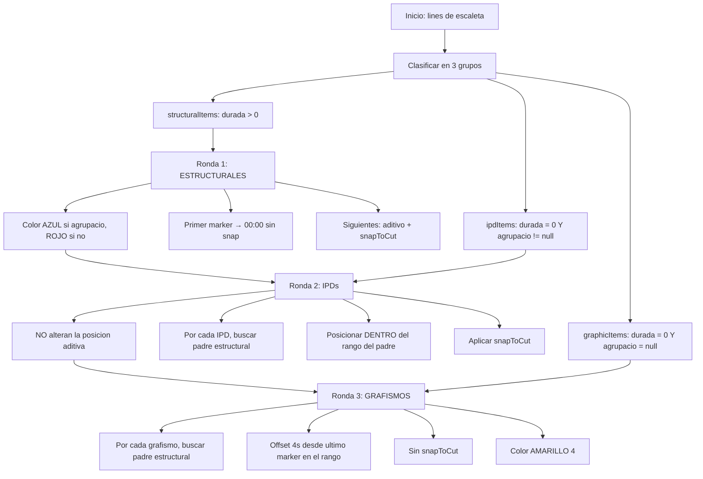

# Plan: Algoritmo de 3 rondas para marcadores de escaleta

## Detalles confirmados con el usuario

- **Color IPDs**: Turquesa (índice 7 según INFO/MARKER_COLORS.md)
- **Lógica IPD**: "El IPD se coloca en el siguiente corte que se encuentre a partir de la conexión" → posIdeal = parentPos (inicio del padre estructural), luego snapToCut desde ese punto

## Problema detectado

El item `01` (IPD IMATGES PG GRÀCIA) tiene `durada: "0:00"` pero `duradaOnAir: "0:33"`. La función `getEffectiveDuradaSec()` actual le asigna 33s, colándolo como estructural. Esto rompe la cuenta aditiva:

```
Fase 1 actual (aditivo):
  01lead (40s) → 0.00s
  01dp (19s) → 64.16s  (ideal 40.00)
  01dir (45s) → 89.28s  (ideal 59.00)
  01 (33s, IPD) → 106.52s ← NO DEBERÍA ESTAR AQUÍ
  02 (115s) → 110.80s  (ideal 137.00) ← POSICIÓN INCORRECTA
```

## Reglas de clasificación (confirmadas por el usuario)

| Condición | Grupo | Ronda | Color |
|-----------|-------|-------|-------|
| `durada` > "0:00" (literal) | **ESTRUCTURAL** | Ronda 1 | AZUL (6) si `agrupacio`, ROJO (1) si no |
| `durada` = "0:00" Y `agrupacio` != null | **IPD** | Ronda 2 | TURQUESA (7) |
| `durada` = "0:00" Y `agrupacio` = null | **GRAFISMO** | Ronda 3 | AMARILLO (4) |

> **Importante**: La clasificación estructural usa SOLO el campo `durada` literal, NO `duradaOnAir`. `getEffectiveDuradaSec()` solo se usará para calcular la duración aditiva de los estructurales, NO para clasificar.

## Nuevo algoritmo: 3 rondas



## Especificación detallada

### Clasificación previa (nuevas líneas ~1068)

```javascript
const getRawDuradaSec = (line) => parseDurada(line.durada || '0:00');

const structuralItems = []; // durada > 0
const ipdItems = [];        // durada = 0 Y agrupacio != null
const graphicItems = [];    // durada = 0 Y agrupacio = null

for (const line of lines) {
    const horaRef = line.horaEntradaOnAir || line.horaEntradaPrevista;
    if (!horaRef || horaRef === "00:00:00") continue;
    
    const dSec = getRawDuradaSec(line);
    if (dSec > 0) {
        structuralItems.push(line);
    } else if (line.agrupacio) {
        ipdItems.push(line);
    } else {
        graphicItems.push(line);
    }
}
```

### Ronda 1: ESTRUCTURALES (~líneas 1090-1125)
Sin cambios funcionales respecto al código actual, solo asegurar que:
- Usa `getEffectiveDuradaSec()` para la duración aditiva (porque los estructurales SIEMPRE tienen durada > 0, así que duradaOnair no interfiere)
- Primer marcador forzado a 00:00 (ya implementado)
- SnapToCut se aplica a todos
- `structuralItemPositions[]` guarda las posiciones finales para referencia de IPDs y grafismos

### Ronda 2: IPDs (nuevo, entre Fase 1 y Fase 2 actuales)

```javascript
// RONDA 2: IPDs (items con duración 0 pero con agrupacio)
// Se colocan dentro del rango de su padre estructural (conexión).
// CON snapToCut porque producen cortes detectables en el timeline.
// NO alteran la posición aditiva de los estructurales.
// Color: TURQUESA (7)

for (const line of ipdItems) {
    // Buscar padre estructural (el estructural que precede a este IPD)
    const parentInfo = findParentStructural(line, lines, structuralItems, structuralItemPositions);
    if (!parentInfo) continue;
    
    const { parentPos, limit } = parentInfo;
    
    // Posición ideal: inicio del padre (siguiente corte a partir de la conexión)
    const posIdeal = parentPos;
    
    // Aplicar snapToCut (los IPD producen cortes detectables)
    const resultado = snapToCut(posIdeal, 'CORTO', cortes, clips, ultimoCorteUsado);
    let posicionFinal = resultado.corte;
    ultimoCorteUsado = resultado.idx;
    
    // Limitar al rango del padre
    posicionFinal = Math.min(posicionFinal, limit - 0.04);
    posicionFinal = Math.max(posicionFinal, parentPos); // No antes que el padre
    
    const safeT = posicionFinal.toFixed(2);
    const num = line.num || '';
    const titol = (line.titol || '').replace(/'/g, "\\'").substring(0, 60);
    const comment = `${num ? num + ' - ' : ''}${titol}`.trim();
    
    log(`📍 [IPD] ${num}: → timeline ${safeT}s (dins de item ${structuralItems[parentInfo.parentIdx].num})`);
    
    if (comment) {
        const script = `Markers.set(${safeT}, '${comment}', 'color=7')`; // TURQUESA
        await callJSX(script);
        placedMarkers.push(parseFloat(safeT));
        placedIpdMarkers.push(parseFloat(safeT));
    }
}
```

### Ronda 3: GRAFISMOS (Fase 2 actual, sin cambios significativos)
- Misma lógica que la actual Fase 2 (líneas 1136-1215)
- Offset 4s, sin snap
- Color AMARILLO (4)
- Solo aplica a `graphicItems`

### Función auxiliar: findParentStructural()
```javascript
const findParentStructural = (line, allLines, structuralItems, structuralItemPositions) => {
    const lineIdx = allLines.indexOf(line);
    for (let i = lineIdx - 1; i >= 0; i--) {
        const prevLine = allLines[i];
        const prevIdx = structuralItems.indexOf(prevLine);
        if (prevIdx >= 0) {
            const parentPos = structuralItemPositions[prevIdx];
            let limit;
            if (prevIdx + 1 < structuralItemPositions.length) {
                limit = structuralItemPositions[prevIdx + 1];
            } else {
                const parentDur = getEffectiveDuradaSec(structuralItems[prevIdx]);
                limit = parentPos + Math.max(parentDur, 4);
            }
            return { parentPos, limit, parentIdx: prevIdx };
        }
    }
    return null;
};
```

## Cambios necesarios en flow_assembly.js

### 1. Clasificación (líneas ~1061-1078)
**REEMPLAZAR** la separación actual en 2 grupos por la nueva separación en 3 grupos.

### 2. getEffectiveDuradaSec (líneas ~983-996)
**MANTENER** para calcular duración aditiva de estructurales, pero NO usarla para clasificar.

### 3. Ronda 1 (líneas ~1081-1124)
**MANTENER** esencialmente igual.

### 4. Ronda 2 - IPDs (NUEVO, ~líneas 1126-1170)
**AÑADIR** nuevo bucle entre Fase 1 y Fase 2 (actual).

### 5. Ronda 3 - GRAFISMOS (líneas ~1126-1215)
**RENOMBRAR** la Fase 2 actual como Ronda 3, cambiando la referencia de `graphicItems` (que ahora solo contendrá items sin agrupacio).

### 6. Variable ultimoCorteUsado
**ATENCIÓN**: Actualmente `ultimoCorteUsado` se comparte entre Ronda 1 y Ronda 2. Para los IPDs, como se colocan DENTRO del rango del padre, el snap debería buscar cortes cerca de la posición ideal. Podría reiniciarse o compartirse. Sugiero:
- Ronda 1: usar `ultimoCorteUsadoEstructural` (nueva variable)
- Ronda 2: usar `ultimoCorteUsado` (compartido con Ronda 1, para que IPDs puedan encontrar cortes cerca)

### 7. Variable placedIpdMarkers
Añadir `const placedIpdMarkers = [];` para tracking de marcadores IPD (no deben interferir con grafismos ni estructurales).

### 8. Resumen de marcadores
Actualizar el log de resumen.

## Aplicación al caso V1 (datos reales)

Items de V1 ordenados por `sequencia`:

| # | num | durada | agrupacio | Grupo |
|---|-----|--------|-----------|-------|
| 1 | 01lead | 0:40 | v1 | **ESTRUCTURAL** |
| 2 | 01lin | 0:00 | v1 | GRAFISMO |
| 3 | 01chy | 0:00 | v1 | GRAFISMO |
| 4 | 01gf1 | 0:00 | v1 | GRAFISMO |
| 5 | 01te | 0:00 | v1 | GRAFISMO |
| 6 | 01gf2 | 0:00 | v1 | GRAFISMO |
| 7 | 01dp | 0:19 | v1 | **ESTRUCTURAL** |
| 8 | 01dir | 0:45 | v1 | **ESTRUCTURAL** |
| 9 | 01 | 0:00 (33s OnAir) | v1 | **IPD** |
| 10 | 02 | 1:55 | v1 | **ESTRUCTURAL** |

(Nota: 01QR tiene agrupacio=null, es GRAFISMO puro, anterior al bloque V1)

**Resultado esperado**:
```
Ronda 1 - ESTRUCTURALES:
  01lead (40s) → 0.00s (CORTO, snap→0.00) ✅
  01dp (19s) → 40.00s (MEDIO, snap→64.16) ✅
  01dir (45s) → 64.16+19=83.16s (LARGO, snap→89.28) ✅
  02 (115s) → 89.28+45=134.28s (LARGO, snap→110.80) ✅

Ronda 2 - IPDs:
  01 → dentro de 01dir [89.28, 89.28+45=134.28] snap

Ronda 3 - GRAFISMOS:
  01lin, 01chy, 01gf1, 01te, 01gf2 → dentro de 01lead [0.00, 64.16] offset 4s
```

## Archivos a modificar

- `js/workflows/flow_assembly.js` — función `placeStructureMarkers()`
