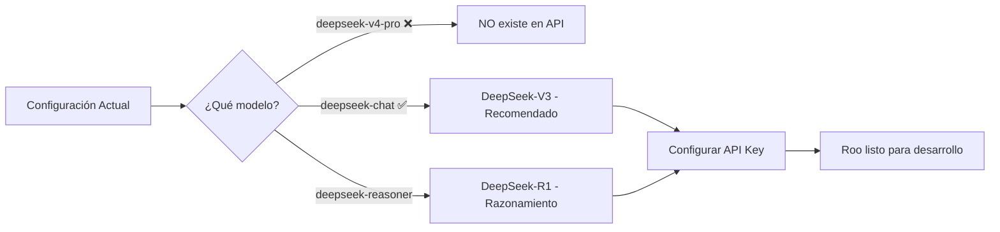

# Plan: Configurar DeepSeek en Roo para el desarrollo de FAST >>> PASS

## 1. Situación Actual

Se ha revisado la configuración del proyecto y de Roo en [`settings.json`](e:/AAA_VSCode_4_WIN/data/user-data/User/settings.json:23). Actualmente tienes esto configurado:

```json
"roo-cline.apiProvider": "deepseek",
"roo-cline.apiBaseUrl": "https://api.deepseek.com",
"roo-cline.apiKey": "sk-TU-API-KEY-DEEPSEEK-AQUI",
"roo-cline.model": "deepseek-v4-pro"
```

## 2. ¿Existe "DeepSeek v4"?

Actualmente **no existe un modelo oficial llamado "deepseek-v4-pro"** en la API de DeepSeek. 

Los modelos reales disponibles en la API oficial de [`api.deepseek.com`](https://api.deepseek.com) son:

| Model ID | Nombre real | Uso recomendado |
|----------|-------------|-----------------|
| `deepseek-chat` | **DeepSeek-V3** | ✅ **Mejor para desarrollo/código** - modelo flagship rápido y potente |
| `deepseek-reasoner` | **DeepSeek-R1** | Razonamiento profundo - más lento pero más reflexivo |

Si la noticia que viste se refiere a un nuevo modelo anunciado por DeepSeek (posiblemente "DeepSeek-V4" o "DeepSeek-R2"), es muy probable que cuando esté disponible en su API, el identificador interno sea algo como `deepseek-chat` (actualizado) o un nuevo ID que ellos documentarán.

**Mi recomendación:** usa **`deepseek-chat`** (DeepSeek-V3) que es el mejor modelo actual de DeepSeek para tareas de programación y desarrollo.

## 3. Plan de Configuración

### Paso 1: Corregir el modelo en VS Code Settings

El archivo [`settings.json`](e:/AAA_VSCode_4_WIN/data/user-data/User/settings.json) debe actualizarse cambiando el modelo de `deepseek-v4-pro` a `deepseek-chat` (o `deepseek-reasoner` si prefieres razonamiento profundo).

**Cambio necesario:**
```json
// ANTES (no funciona):
"roo-cline.model": "deepseek-v4-pro",

// DESPUÉS (recomendado):
"roo-cline.model": "deepseek-chat",
```

### Paso 2: Colocar tu API Key real

Como bien dices, no debes compartir tu API Key aquí. Para configurarla tienes **dos opciones**:

**Opción A** *(recomendada)* — En el propio VS Code, abre la extensión Roo:
1. Haz clic en el icono de Roo en la barra lateral
2. Abre la configuración (⚙️) 
3. Selecciona "DeepSeek" como proveedor
4. Pega tu API Key en el campo correspondiente
5. Selecciona el modelo `deepseek-chat`

**Opción B** — Editar directamente el [`settings.json`](e:/AAA_VSCode_4_WIN/data/user-data/User/settings.json):
- Reemplazar `"sk-TU-API-KEY-DEEPSEEK-AQUI"` por tu API Key real
- Cambiar el modelo a `"deepseek-chat"`

### Paso 3: Verificar que funciona

Una vez configurado, Roo debería usar DeepSeek-V3 (`deepseek-chat`) para todas las operaciones de desarrollo del proyecto FAST >>> PASS.

## 4. Resumen Visual del Cambio



## 5. Próximos Pasos

1. ✅ Decidir si usar `deepseek-chat` (V3) o `deepseek-reasoner` (R1)
2. ✅ Actualizar el modelo en `settings.json`
3. ⬜ Colocar la API Key real (tú mismo en la UI de Roo)
4. ⬜ Verificar que las llamadas a la API funcionan correctamente

---

*Documento generado como parte del plan de configuración de Roo + DeepSeek para el proyecto FAST >>> PASS*
