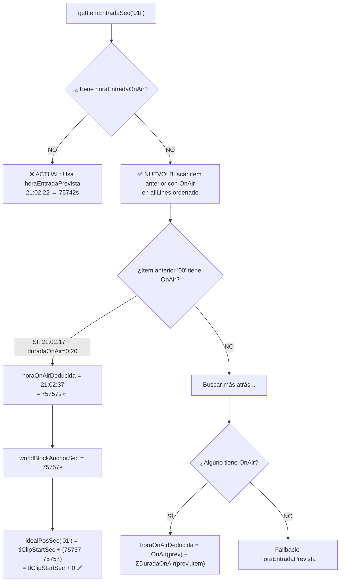
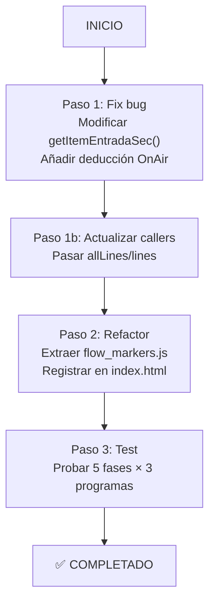

# 📋 PLAN DE TRABAJO — 2026-05-21

> **Proyecto**: FAST PASS  
> **Modo actual**: Architect (planificación)  
> **Próximo modo**: Code (implementación)

---

## ✅ COMPLETADO (Sesión actual)

- [x] Formateo de 3 JSONs del 2026-05-20 (`check_and_fmt.ps1`)
- [x] Verificación: no existen JSONs del 2026-05-21 aún
- [x] **Fix 1**: Bug de `idealPosSec` del faro "01" — OnAirDeducido (mecanismo de deducción de TCs para ítems sin `horaEntradaOnAir`)
- [x] **Fix 2**: Bug de àncora `blockInSec` — desplazamiento sistemático de -46s en TNVespre V1. La fórmula de marcadores usaba `worldBlockAnchorSec` (primer ítem estructural) en vez de `block.in` del clip cleanFeed.

---

## 🔴 PENDIENTE

### 1. 🐛 Fix: Bug de `idealPosSec` del faro "01" (prioridad MÁXIMA)

---

#### 🔬 Análisis del bug

**Síntoma**: El marcador del vídeo "01" se coloca ~15s después del inicio del clip V1, cuando debería ser ~5s.

**Datos reales (TN_VESPRE)**:
```
"01i" (Intro): horaEntradaPrevista = 21:02:22, sin horaEntradaOnAir
"01"  (Vídeo): horaEntradaOnAir = 21:02:37 (75757s), duradaOnAir = 1:47
```

**Cálculo actual defectuoso**:
```
idealPosSec = tlClipStartSec + (itemOnAirSec - anchorOnAirSec)
            = tlClipStartSec + (75757 - 75742)
            = tlClipStartSec + 15.00s  ← BUG: 15s de offset
```

`anchorOnAirSec = 75742s` viene de [`getItemEntradaSec("01i")`](js/core/escaleta_reader.js:1113), que al no tener `horaEntradaOnAir` usa el fallback `horaEntradaPrevista: 21:02:22 = 75742s`.

---

#### 🔄 Cadena causal corregida



---

#### 🛠️ Corrección propuesta

**Archivo**: [`js/core/escaleta_reader.js`](js/core/escaleta_reader.js), función [`getItemEntradaSec()`](js/core/escaleta_reader.js:1113)

**Nueva cadena de resolución**:
```
1. item.horaEntradaOnAir                          ← directo (más fiable)
2. 🆕 horaOnAirDeducida = OnAir(item_anterior) + ΣDuradaOnAir(prev→item)  ← NUEVO
3. item.horaEntradaPrevista                        ← fallback (estimación planning)
```

**Cambio en la firma**: Añadir parámetro opcional `allLines` (array ordenado de ítems):

```javascript
// ANTES
getItemEntradaSec: function (item) { ... }

// DESPUÉS
getItemEntradaSec: function (item, allLines) { ... }
```

**Algoritmo de deducción** (nuevo paso 2):

```javascript
// Paso 2: Deducir de item anterior con OnAir
if (allLines && allLines.length > 0) {
    // Encontrar índice del item en allLines
    var itemIdx = -1;
    for (var i = 0; i < allLines.length; i++) {
        if (allLines[i] === item) { itemIdx = i; break; }
    }
    if (itemIdx > 0) {
        // Buscar hacia atrás el primer item con horaEntradaOnAir válida
        // Acumular duraciones de items sin OnAir en el camino
        var deducidaSec = null;
        var acumulado = 0;
        for (var j = itemIdx - 1; j >= 0; j--) {
            var prevItem = allLines[j];
            var prevOnAir = prevItem.horaEntradaOnAir;
            if (prevOnAir && prevOnAir !== "00:00:00") {
                deducidaSec = this.tcToSeconds(prevOnAir) + acumulado;
                break;
            }
            // Acumular duradaOnAir del item sin OnAir (o durada si no hay OnAir)
            var d = prevItem.duradaOnAir;
            if (!d || d === "0:00") d = prevItem.durada;
            acumulado += this.parseDurada(d || "0:00");
        }
        if (deducidaSec !== null) {
            log("🔍 [DEDUCCIÓ] OnAir deduït per a '" + (item.num || "?") + 
                "': " + deducidaSec.toFixed(2) + "s (des de " + j + " items enrere)");
            return deducidaSec;
        }
    }
}
```

**Callers que deben pasar `allLines`**:

| # | Ubicación | Cambio necesario |
|---|-----------|-----------------|
| 1 | [`escaleta_reader.js:848`](js/core/escaleta_reader.js:848) — `worldBlockAnchorSec` | Pasar `allLines` (ya disponible en `calcPrecisionTrimBounds`) |
| 2 | [`escaleta_reader.js:861`](js/core/escaleta_reader.js:861) — Tier 1 IN | Pasar `allLines` |
| 3 | [`flow_assembly.js:3324`](js/workflows/flow_assembly.js:3324) — `placeMarksCrudo` | Pasar `lines` (array ordenado del bloque) |
| 4 | [`escaleta_reader.js:1147`](js/core/escaleta_reader.js:1147) — `getItemSortidaSec` | Pasar `allLines` (añadir parámetro también a `getItemSortidaSec`) |

**Nota**: Es crucial que el array pasado esté **ordenado por hora de entrada** (ascendente), que es como `allLines` y `lines` ya están ordenados en todos los callers.

---

### 2. 📦 Refactor: Extraer `flow_markers.js`

Crear [`js/workflows/flow_markers.js`](js/workflows/flow_markers.js) extrayendo de [`flow_assembly.js`](js/workflows/flow_assembly.js) las funciones de marcadores (~2300 líneas).

**Funciones a mover**:

| Función | Línea ~ | Notas |
|---------|---------|-------|
| `placeMarkers` | 65 | Dispatcher `crudo`/`estructura`/`cocinado` |
| `placeStructureMarkers` | 765 | Función principal (~2300 líneas) |
| `placeMarksCrudo` | ~3100 | Marcadores modo crudo |
| `snapToCutFaro` | 1610 | Snap simple para faros |
| `snapToCut` | 920 | Snap topológico + REGLA CERO |
| `agruparEnSegmentos` | ~1830 | Agrupación por segmentos entre faros |
| `greedySnapshot` | ~1999 | Greedy bidireccional L→R / R→L |
| `compararDirecciones` | ~2090 | Comparador L→R vs R→L |
| `buildTimelineFootprint` | ~1241 | Huella del timeline (density breaks) |
| `buildEscaletaFootprint` | ~1284 | Huella de escaleta |
| `affineRANSAC` | ~1327 | Regresión afín robusta |
| `matchFootprints` | ~1435 | Alineación de huellas |
| `clasificarItem` | 890 | Clasificación por duración/sufijo |
| `isGraphicByNum` | 1119 | Detección de sufijos gráficos |
| `GRAPHIC_SUFFIXES` | 1084 | Set de sufijos gráficos |
| `FORCED_STRUCTURAL_SUFFIXES` | 1109 | Set de sufijos estructurales forzados |

**Qué se queda en `flow_assembly.js`**:
- `runAutoPlacement` (l.84) — ensamblaje automático
- `_placeMagicChyrons` (l.427) — colocación de chyrons
- `_getStructureFromMarkers` — lectura de marcadores existentes
- Funciones helper de clips (`getClipsLogic`, etc.)

**Registro en `index.html`**: Añadir `<script src="js/workflows/flow_markers.js"></script>`

---

### 3. 🧪 Test en Premiere Pro

Probar con TN_VESPRE, TN_MIGDIA, TN_COMARQUES:
- [ ] F1/5 Marcadores Raw — verificar faro "01" a posición correcta (~5s dentro del clip)
- [ ] F2/5 SNAP — faros con snap
- [ ] F3/5 COINC — D3-COINC + FARO-START/END
- [ ] F4/5 APROX — greedy bidireccional
- [ ] F5/5 COMPLET — gráficos + validación

---

## 🔄 Flujo de trabajo



---

## 📁 Archivos a modificar

| Archivo | Cambio |
|---------|--------|
| [`js/core/escaleta_reader.js`](js/core/escaleta_reader.js) | Añadir paso 2 de deducción en `getItemEntradaSec()` + actualizar `getItemSortidaSec()` |
| [`js/workflows/flow_assembly.js`](js/workflows/flow_assembly.js) | Pasar `lines` a `getItemEntradaSec()` en `placeMarksCrudo`; extraer funciones a `flow_markers.js` |
| [`js/workflows/flow_markers.js`](js/workflows/flow_markers.js) | 🆕 Nuevo archivo con ~2300 líneas extraídas |
| [`index.html`](index.html) | Registrar `<script>` de `flow_markers.js` |

---

## ⚠️ Notas

- `getItemEntradaSec` con el nuevo parámetro `allLines` es **retrocompatible**: si no se pasa, el paso 2 se salta y funciona igual que antes.
- La deducción acumula `duradaOnAir` (o `durada` como fallback) de items intermedios, igual que hace `calcPrecisionTrimBounds` con las caretas.
- Para el caso de `"01i"`: si el item anterior (ej: `"00"`) tiene `horaEntradaOnAir=21:02:17` y `duradaOnAir=0:20`, la deducción dará `21:02:37` = 75757s, que coincide con el OnAir real de `"01"`. El ancla será correcta.
