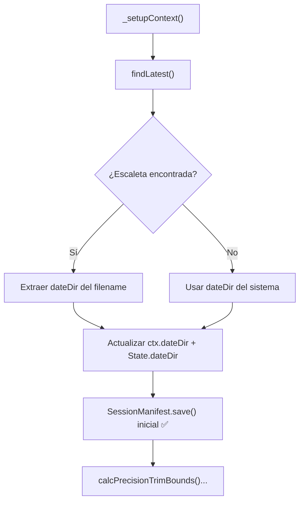
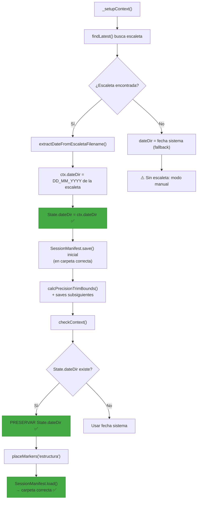

# PLAN: Coherencia de `dateDir` — Fuente Única de Fecha de Emisión

**Versión**: 1.1.0
**Fecha**: 2026-05-18
**Estado**: ✅ Implementado (D7.1-D7.6)

---

## 🩺 Diagnóstico

### Síntoma

Al ejecutar [`placeMarkers('estructura')`](js/workflows/flow_assembly.js:69) sobre TNV V1:

```
📂 [SessionManifest] Manifest carregat: 0 items d'escaleta
⚠️ No es troben items d'escaleta al manifest. Executa primer «Muntar».
```

El manifest **sí existe** en disco pero contiene 0 `escaletaItems`. Esto ocurrió en un proyecto generado con `Muntar` el día 18_05_2026 para una escaleta del 17_05_2026.

### Causa Raíz

`dateDir` tiene **dos fuentes que compiten** y no hay un único punto de verdad:

| Fuente | Ubicación | Valor en el bug |
|--------|-----------|-----------------|
| `getFormattedDate()` → reloj del sistema | [`_setupContext()`](js/workflows/flow_mainButton.js:738) | `18_05_2026` |
| `getFormattedDate()` → reloj del sistema | [`checkContext()`](js/core/4_Context.js:47) | `18_05_2026` |
| Extracción del nombre de escaleta | [`_runNew()` L87-99](js/workflows/flow_mainButton.js:87) | `17_05_2026` |

**Secuencia exacta del fallo:**

```
┌─ _runNew() ─────────────────────────────────────────────────────┐
│ 1. _setupContext()           → dateDir = "18_05_2026" (sistema) │
│ 2. SessionManifest.save()    → 18_05_2026/TNV_V1.fastpass.json  │  ← SIN items
│ 3. findLatest()              → TN_VESPRE_20260517_215504.json   │
│ 4. ctx.dateDir = "17_05_2026" → CORRECCIÓN (demasiado tarde)    │
│ 5. SessionManifest.save()    → 17_05_2026/TNV_V1.fastpass.json  │  ← CON items ✓
└─────────────────────────────────────────────────────────────────┘
                              ↓
┌─ checkContext() ────────────────────────────────────────────────┐
│ dateDir = getFormattedDate() → "18_05_2026"                     │
│ Object.assign(State, ctx)    → SOBRESCRIBE State.dateDir        │  ← BUG
└─────────────────────────────────────────────────────────────────┘
                              ↓
┌─ placeMarkers('estructura') ────────────────────────────────────┐
│ State.dateDir = "18_05_2026"  ← INCORRECTO                      │
│ manifestPath = ...\18_05_2026\TNV_V1.fastpass.json              │
│ → 0 escaletaItems → ERROR                                       │
└─────────────────────────────────────────────────────────────────┘
```

### Consecuencias

1. **Manifest huérfano**: El primer `save` crea un archivo en la carpeta del sistema, sin datos de escaleta. Este archivo "contamina" las búsquedas futuras.
2. **Fragmentación**: Los datos quedan dispersos en dos directorios diferentes (`18_05_2026` y `17_05_2026`).
3. **Imposibilidad de marcadores**: `placeStructureMarkers` carga el manifest equivocado.

---

## 🗺️ Mapa de Fuentes y Consumidores de `dateDir`

### Productores (asignan `dateDir`)

| # | Archivo:Línea | Método | Origen del valor |
|---|---------------|--------|-----------------|
| P1 | [`flow_mainButton.js:738`](js/workflows/flow_mainButton.js:738) | `_setupContext()` | `getFormattedDate()` (sistema) |
| P2 | [`4_Context.js:47`](js/core/4_Context.js:47) | `checkContext()` | `getFormattedDate()` (sistema) |
| P3 | [`flow_mainButton.js:95-99`](js/workflows/flow_mainButton.js:95) | `_runNew()` | Extraído de `jsonMeta.filename` (escaleta) |
| P4 | [`flow_assembly.js:789`](js/workflows/flow_assembly.js:789) | `placeStructureMarkers()` | `getFormattedDate()` (fallback, sistema) |

### Consumidores (leen `dateDir`)

| # | Archivo:Línea | Método | Uso |
|---|---------------|--------|-----|
| C1 | [`flow_mainButton.js:53`](js/workflows/flow_mainButton.js:53) | `_runNew()` | `folderPath` del `.prproj` |
| C2 | [`flow_mainButton.js:65`](js/workflows/flow_mainButton.js:65) | `_runNew()` | `SessionManifest.save()` inicial ⚠️ |
| C3 | [`flow_mainButton.js:259`](js/workflows/flow_mainButton.js:259) | `_runNew()` | `SessionManifest.save()` con bounds |
| C4 | [`flow_mainButton.js:363`](js/workflows/flow_mainButton.js:363) | `_runNew()` | `SessionManifest.save()` fallback |
| C5 | [`flow_mainButton.js:533`](js/workflows/flow_mainButton.js:533) | `_runUpdate()` | `newPath` promoción |
| C6 | [`flow_mainButton.js:571`](js/workflows/flow_mainButton.js:571) | `_runGo()` | `folderPath` |
| C7 | [`flow_mainButton.js:601`](js/workflows/flow_mainButton.js:601) | `_runLoad()` | `folderPath` |
| C8 | [`flow_mainButton.js:694`](js/workflows/flow_mainButton.js:694) | `_fullScan()` | `folderDest` búsqueda proyectos |
| C9 | [`4_Context.js:55`](js/core/4_Context.js:55) | `checkContext()` | `folderPath` escaneo |
| C10 | [`11_Configuracio.js:129`](js/core/11_Configuracio.js:129) | `getProjectName()` | Extrae `mmdd` de `dateDir` |
| C11 | [`16_Analysis_Logic.js:24`](js/logic/16_Analysis_Logic.js:24) | `_getPath()` | Extrae `dd_mm` de `dateDir` |
| C12 | [`session_manifest.js:21`](js/core/session_manifest.js:21) | `getPath()` | `folder + filename` |
| C13 | [`session_manifest.js:85`](js/core/session_manifest.js:85) | `_empty()` | `projectFolder` |

---

## 🎯 Principio de Diseño

> **La fecha de emisión del bloque es la ÚNICA fuente de verdad para `dateDir`.**  
> Se deduce del nombre del archivo JSON de escaleta (`TN_VESPRE_20260517_215504.json` → `17_05_2026`).  
> Una vez establecida, **ningún** otro componente debe sobrescribirla con la fecha del sistema.

---

## 📋 Plan de Implementación

### D7.1 — Extraer fecha de emisión ANTES del primer `save`

**Objetivo**: Mover la corrección de `dateDir` al inicio de `_runNew()`, **antes** de `SessionManifest.save()` inicial.

**Archivo**: [`js/workflows/flow_mainButton.js`](js/workflows/flow_mainButton.js)

**Cambio**:
- Reordenar el bloque `_runNew()` para que:
  1. `_setupContext()` obtenga el ctx inicial (con `dateDir` del sistema como fallback)
  2. `findLatest()` encuentre la escaleta
  3. **Extraer `dateDir` de la escaleta ANTES de cualquier `save`**
  4. Actualizar `ctx.dateDir` y `State.dateDir`
  5. Ahora sí: `SessionManifest.save()` inicial (ya con la fecha correcta)
  6. Continuar con el flujo normal



### D7.2 — `checkContext()` NO debe sobrescribir `State.dateDir`

**Objetivo**: Impedir que [`checkContext()`](js/core/4_Context.js:47) restaure `dateDir` a la fecha del sistema cuando ya hay un valor válido en `State`.

**Archivo**: [`js/core/4_Context.js`](js/core/4_Context.js)

**Cambio**:
```diff
- dateDir: getUtils().getFormattedDate().replace(/"/g, "").trim()
+ dateDir: (window.FASTPASS_UI.State && window.FASTPASS_UI.State.dateDir) 
+          || getUtils().getFormattedDate().replace(/"/g, "").trim()
```

**Razonamiento**: Si `State.dateDir` ya fue corregido por `_runNew()`, se preserva. Si no (primera carga, State vacío), se usa la fecha del sistema como fallback razonable.

### D7.3 — `placeStructureMarkers()` debe usar `State.dateDir` sin fallback

**Objetivo**: Eliminar el fallback a fecha del sistema en [`placeStructureMarkers()`](js/workflows/flow_assembly.js:788).

**Archivo**: [`js/workflows/flow_assembly.js`](js/workflows/flow_assembly.js)

**Cambio**: La línea 788-789 ya verifica `if (!ctx.dateDir)`. El problema es que `State.dateDir` fue sobreescrito por `checkContext()`. Con D7.2 resuelto, este fallback nunca debería activarse en condiciones normales. Añadir un `log` de warning si se activa:

```diff
  if (!ctx.dateDir) {
+     log("⚠️ [placeStructureMarkers] dateDir no disponible a State. Usant data del sistema com a fallback.");
      ctx.dateDir = getUtils().getFormattedDate().replace(/["\s]/g, "").trim();
  }
```

### D7.4 — `_runUpdate()`, `_runGo()`, `_runLoad()` deben resolver `dateDir` desde el proyecto abierto

**Objetivo**: Cuando se reabre un proyecto existente, `dateDir` debe deducirse del path del proyecto (que contiene `DD_MM_YYYY`), no del reloj.

**Archivo**: [`js/workflows/flow_mainButton.js`](js/workflows/flow_mainButton.js)

**Cambio**: Estos tres métodos llaman a `_setupContext()` que siempre asigna `dateDir` del sistema. En su lugar:

- **`_runUpdate()`**: El proyecto ya está abierto. Leer `State.dateDir` (preservado por D7.2) o extraerlo del path del proyecto.
- **`_runGo()`** y **`_runLoad()`**: Reciben `data.dateDir` desde el contexto del botón (GO pasa el proyecto seleccionado). Usar ese valor.

Alternativa más robusta: Modificar [`_setupContext()`](js/workflows/flow_mainButton.js:734) para que **primero** intente usar `State.dateDir` (si existe) y solo use `getFormattedDate()` como fallback:

```diff
  _setupContext: async function () {
      const config = FASTPASS_UI.Config.get();
      const idProg = document.getElementById('programa').value;
      const progData = config.mapeoProgramas[idProg];
-     const dateDir = getUtils().getFormattedDate().replace(/["\s]/g, "").trim();
+     const stateDateDir = (window.FASTPASS_UI.State && window.FASTPASS_UI.State.dateDir);
+     const dateDir = stateDateDir || getUtils().getFormattedDate().replace(/["\s]/g, "").trim();
      
      return { config, progData, programa: idProg, bloque: document.getElementById('bloc').value, dateDir };
  }
```

### D7.5 — Centralizar extracción de fecha desde filename de escaleta

**Objetivo**: Crear una función única que extraiga `DD_MM_YYYY` desde un filename de escaleta, para evitar código duplicado.

**Archivo nuevo o modificación**: [`js/core/utils.js`](js/core/utils.js) o [`js/core/escaleta_reader.js`](js/core/escaleta_reader.js)

**Función propuesta**:
```javascript
/**
 * Extreu la data d'emissió en format DD_MM_YYYY des del nom d'un fitxer d'escaleta.
 * Format esperat: TN_VESPRE_20260517_215504.json → "17_05_2026"
 * @param {string} filename - Nom del fitxer (sense ruta)
 * @returns {string|null} Data en format DD_MM_YYYY, o null si no es pot extreure
 */
extractDateFromEscaletaFilename: function(filename) {
    const parts = filename.replace('.json', '').split('_');
    if (parts.length >= 2) {
        const yyyymmdd = parts[parts.length - 2];
        if (yyyymmdd && yyyymmdd.length === 8 && /^\d{8}$/.test(yyyymmdd)) {
            const dd = yyyymmdd.substring(6, 8);
            const mm = yyyymmdd.substring(4, 6);
            const yyyy = yyyymmdd.substring(0, 4);
            return dd + '_' + mm + '_' + yyyy;
        }
    }
    return null;
}
```

**Usar en**:
- [`flow_mainButton.js:87-99`](js/workflows/flow_mainButton.js:87) — reemplazar la extracción inline
- [`_setupContext()`](js/workflows/flow_mainButton.js:734) — si se reabre un proyecto existente, deducir del project path

### D7.6 — Sincronizar `Analysis._getPath()` y `Config.naming.getProjectName()`

**Objetivo**: Verificar que estos consumidores funcionan correctamente con el `dateDir` ya corregido.

**Archivos**:
- [`js/logic/16_Analysis_Logic.js:24`](js/logic/16_Analysis_Logic.js:24): `ctx.dateDir.substring(0, 5)` extrae `DD_MM` — esto es correcto siempre que `dateDir` tenga el formato `DD_MM_YYYY`.
- [`js/core/11_Configuracio.js:129`](js/core/11_Configuracio.js:129): `d[1] + d[0]` extrae `MMDD` — correcto.

Ambos dependen de `ctx.dateDir` tener el valor correcto. Con D7.1-D7.4 implementados, esto queda garantizado.

---

## 📊 Diagrama de Flujo Corregido



---

## 📁 Archivos a Modificar

| # | Archivo | Cambio | Riesgo |
|---|---------|--------|--------|
| D7.1 | [`flow_mainButton.js`](js/workflows/flow_mainButton.js) | Reordenar bloque 65-281: corrección dateDir antes del primer save | Medio — toca la secuencia central del flujo |
| D7.2 | [`4_Context.js`](js/core/4_Context.js) | L47: preservar `State.dateDir` si existe | Bajo — cambio de una línea |
| D7.3 | [`flow_assembly.js`](js/workflows/flow_assembly.js) | L788: añadir warning si fallback se activa | Mínimo — solo logging |
| D7.4 | [`flow_mainButton.js`](js/workflows/flow_mainButton.js) | `_setupContext()`: preservar `State.dateDir`; `_runUpdate/Load/Go`: usar data.dateDir | Medio — afecta múltiples flujos |
| D7.5 | [`utils.js`](js/core/utils.js) | Nueva función `extractDateFromEscaletaFilename()` | Bajo — función nueva, sin side effects |
| D7.6 | Sin cambios | Verificación solamente | Nulo |

---

## ✅ Criterios de Aceptación

1. **TNV V1 con escaleta del 17_05_2026**: `Muntar` crea proyecto y manifest en `17_05_2026/`, no en `18_05_2026/`.
2. **Tras `checkContext()`**: `State.dateDir` mantiene `17_05_2026`, no se sobrescribe.
3. **`placeMarkers('estructura')`**: Encuentra el manifest correcto con `escaletaItems` poblados.
4. **`UPDATE`/`LOAD`/`GO`**: Reabren proyecto usando la fecha del directorio existente, no la del sistema.
5. **Sin regresión**: TNM V2 (caso fallback) sigue funcionando correctamente.
