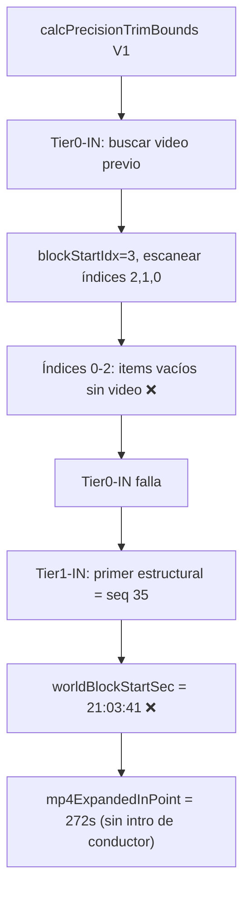
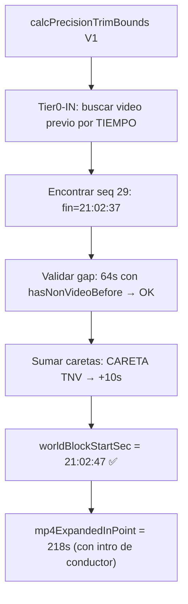

# PLAN: Fix Frontera V1 - Intro del Conductor

## 🔍 Diagnóstico

### Síntoma
Al cargar el bloque TN_VESPRE V1, el clip de cleanFeed se recorta incorrectamente: empieza en `21:03:41` (primer vídeo con OnAir del bloque) en vez de ~`21:02:37` (final del último vídeo anterior + caretas). El resultado es que la intro del conductor (~64s) queda fuera del bloque.

### Causa Raíz
El algoritmo [`calcPrecisionTrimBounds`](js/core/escaleta_reader.js:700) tiene dos sub-problemas en su **Tier0-IN**:

#### Problema A: Búsqueda por índice de array en vez de por tiempo cronológico

```javascript
// Línea 748: Escaneo hacia atrás por índice de array
for (let i = blockStartIdx - 1; i >= 0; i--) {
    const prev = allLines[i];
    // ...
}
```

`blockStartIdx` se calcula como `allLines.indexOf(blockLines[0])`. Para V1, `blockLines[0]` es seq 4 ("V1 - Cristina") que aparece en el índice **3** del array. El bucle escanea índices 2→1→0, pero esos ítems (seq 1-3) son marcadores vacíos sin vídeo. El verdadero predecesor cronológico (seq 29 "ACTE ILLA-JUNQUERAS", índice **28**) está DESPUÉS en el array y nunca se alcanza.

**Por qué ocurre**: Los ítems de `agrupacio="v1"` están intercalados en la escaleta. Los items estructurales de V1 (seq 4, 31-34) aparecen al principio del array pero cronológicamente son posteriores a los ítems del tramo general (`agrupacio=null`).

```
Array: [seq1, seq2, seq3(ag=V), seq4(ag=v1), seq5, seq6, ..., seq29(video prev), ..., seq34(ag=v1), seq35(ag=v1)]
                          ↑ blockStartIdx=3                               ↑ el video previo real está aquí
                          |← búsqueda hacia atrás (vacía) →|
```

#### Problema B: `MAX_TIER0_GAP_SEC=15` demasiado restrictivo

```javascript
const MAX_TIER0_GAP_SEC = 15;
```

Aunque se encontrara el video previo, el gap de ~64s (entre `21:02:37` y `21:03:41`) excede los 15s y el algoritmo lo descartaría. Los bloques V tienen intros de conductor legítimas que pueden durar 60-90s.

### Datos de la escaleta

| Campo | Valor |
|-------|-------|
| `block.in` (cleanFeed) | `21:02:41` |
| `block.out` (cleanFeed) | `21:05:03` |
| Último video previo con OnAir | seq 29: `21:01:51` + `0:46` = fin **21:02:37** |
| Careta entre medias | seq 28 "CARETA TNV": `21:01:45-21:02:15` (corregida a 10s) |
| Primer ítem v1 (Off sin tiempo) | seq 34 "Off", `num="02f"`, `durada="0:00"` |
| Primer ítem estructural v1 | seq 35: `horaEntradaOnAir="21:03:41"` |
| Gap conductor | 21:02:37 → 21:03:41 = **64s** |
| Log real | `Tier1-IN: "02" entrada=21:03:41 → 75821.00s` (Tier0 falló) |

### Flujo actual (roto)



### Flujo esperado (corregido)



---

## 🏗️ Plan de Implementación

### Cambio 1: Búsqueda por tiempo en Tier0-IN

**Archivo**: [`js/core/escaleta_reader.js`](js/core/escaleta_reader.js:738-781)

Reemplazar el bucle de escaneo hacia atrás por índice de array con una búsqueda cronológica:

```javascript
// NUEVO: Construir lista de todos los items con video+OnAir, ordenados por tiempo
const allOnAirVideos = [];
for (let i = 0; i < allLines.length; i++) {
    const l = allLines[i];
    if (l.flotant === true) continue;
    if (l.teVideo === true && l.horaEntradaOnAir) {
        const startSec = this.tcToSeconds(l.horaEntradaOnAir);
        const durSec = this.parseDurada(l.duradaOnAir || l.durada);
        allOnAirVideos.push({ item: l, idx: i, startSec, endSec: startSec + durSec });
    }
}
allOnAirVideos.sort((a, b) => a.startSec - b.startSec);

// Buscar el video más cercano cuyo endSec < blockRefSec
let prevVideoData = null;
const blockRefSec = firstBlockItem && firstBlockItem.horaEntradaPrevista
    ? this.tcToSeconds(firstBlockItem.horaEntradaPrevista)
    : null;

if (blockRefSec !== null) {
    for (const vid of allOnAirVideos) {
        if (vid.endSec < blockRefSec) {
            if (!prevVideoData || vid.endSec > prevVideoData.endSec) {
                prevVideoData = vid;
            }
        }
    }
}

if (prevVideoData) {
    // Validación de gap adaptativa
    const gap = blockRefSec - prevVideoData.endSec;
    const hasNonVideoIntro = this.hasNonVideoItemsBefore(data, blockId).before;
    const maxGap = hasNonVideoIntro ? 120 : 15;  // ← RELAJADO para bloques con intro
    
    if (gap <= maxGap) {
        worldBlockStartSec = prevVideoData.endSec;
        InTier = 10;
        log(`   ✅ Tier0-IN: item anterior "${prevVideoData.item.num}" acaba a ${worldBlockStartSec.toFixed(2)}s`);
        
        // Buscar caretas entre el video previo y el inicio del bloque
        const caretas = this._findCaretasBetween(allLines, prevVideoData.idx, blockStartIdx, data);
        if (caretas.totalDur > 0) {
            worldBlockStartSec += caretas.totalDur;
            log(`   📺 Tier0-IN: +${caretas.totalDur}s per caretes...`);
        }
    } else {
        log(`   ⏭️ Tier0-IN: gap=${gap.toFixed(0)}s > maxGap=${maxGap}s. Usant Tier1.`);
    }
}
```

### Cambio 2: Ajuste de `_findCaretasBetween` para búsqueda cronológica

**Problema secundario**: [`_findCaretasBetween`](js/core/escaleta_reader.js:644) también usa índices de array (`fromIdx` a `toIdx`). Cuando el video previo está en un índice posterior al inicio del bloque, el rango `fromIdx+1` a `toIdx-1` está vacío o es incorrecto.

**Solución**: Modificar `_findCaretasBetween` para aceptar también rangos de tiempo (TCs) como alternativa a índices. Cuando `toIdx < fromIdx`, buscar por tiempo en vez de por índice.

```javascript
_findCaretasBetween: function (allLines, fromIdx, toIdx, data) {
    // Si los índices están invertidos (video previo está después en el array),
    // buscar por rango de tiempo en vez de por rango de índice
    if (toIdx < fromIdx) {
        // fromIdx = índice del video previo (cronológicamente anterior)
        // toIdx = índice del primer item del bloque (cronológicamente posterior)
        // Recorrer todo allLines buscando caretas entre los dos tiempos
        const fromItem = allLines[fromIdx];
        const toItem = allLines[toIdx];
        if (!fromItem || !toItem) return { totalDur: 0, names: [] };
        
        const fromEndSec = this.tcToSeconds(fromItem.horaEntradaOnAir) + 
                           this.parseDurada(fromItem.duradaOnAir || fromItem.durada);
        const toStartSec = this.tcToSeconds(toItem.horaEntradaPrevista);
        
        // Buscar en todo allLines items "CARETA" cuyo tiempo esté entre fromEndSec y toStartSec
        let totalDur = 0;
        const names = [];
        for (let i = 0; i < allLines.length; i++) {
            const item = allLines[i];
            if (!item || !item.titol) continue;
            if (item.flotant === true) continue;
            const title = item.titol.trim().toUpperCase();
            if (title.indexOf('CARETA') !== -1) {
                const itemStart = this.tcToSeconds(item.horaEntradaPrevista);
                if (itemStart >= fromEndSec && itemStart < toStartSec) {
                    const dur = data
                        ? this._getCorrectedDuration(item, data)
                        : this.parseDurada(item.duradaOnAir || item.durada);
                    totalDur += dur;
                    names.push(item.titol);
                }
            }
        }
        return { totalDur, names };
    }
    // ... código existente sin cambios para el caso normal (toIdx > fromIdx) ...
}
```

### Cambio 3 (alternativo más simple): Usar `getNeighbourOnAirTimes` existente

En vez de los cambios 1 y 2, podríamos extender [`getNeighbourOnAirTimes`](js/core/escaleta_reader.js:509) para que también busque items con OnAir de bloques `agrupacio=null` (tramo general) cuando el bloque actual es el primero del cleanFeed.

Ventaja: cambios mínimos, reusa infraestructura existente.
Desventaja: solo funciona si el video previo está en `agrupacio=null`; no cubre el caso general de items intercalados.

---

## 📋 Tareas

1. **Implementar Cambio 1**: Reemplazar búsqueda por índice con búsqueda cronológica en Tier0-IN de [`calcPrecisionTrimBounds`](js/core/escaleta_reader.js:738)
2. **Implementar Cambio 2**: Adaptar [`_findCaretasBetween`](js/core/escaleta_reader.js:644) para manejar rangos de tiempo cuando los índices están invertidos
3. **Verificar no-regresión**: Confirmar que V2, V3, V4 y otros programas (TNC, TNM) siguen funcionando igual
4. **Probar en Premiere Pro**: TN_VESPRE V1 con la escaleta del 18/05/2026
