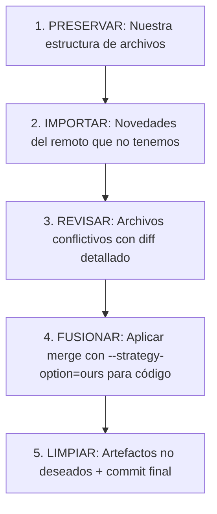

# PLAN: Fusión Local ↔ Remoto (origin/main)

**Fecha**: 2026-06-08
**Estado**: 🔴 Pendiente de ejecución
**Contexto**: Ramas divergentes desde `f5aa5ce` ("Delimitadores de secuencia")

---

## 📅 Cronología de Cambios

```
f5aa5ce — Delimitadores de secuencia (ancestro común)
│
├─ 🌐 REMOTO (origin/main): 30 abril — 3 mayo 2026
│   ├─ 50a5716 Mejora Rendimiento y ffmpeg          (30 abr 19:49)
│   ├─ 15fc480 Polling ffmpeg                       (30 abr 19:54)
│   └─ 0b0e66e PLAN MARKERS con Escaleta            ( 3 may 02:45)
│
└─ 💻 LOCAL (HEAD): 28 mayo — 8 junio 2026
    ├─ 19369c3 BUG #14: fallback _getColorIdx        (28 may)
    ├─ 523aa8c BUG #15: F2·Deducido primer ítem      (28 may)
    ├─ dbb4548 BUG #16: fix cross-agrupacio           (28 may)
    ├─ 55b4872 Reestructuración Harness Engineering   (28 may)
    ├─ 0545a49 Consolidación bin/ + archive/          (29 may)
    ├─ 1cc192a Consolidación final + skills           (29 may)
    └─ 7c5ab09 Handoff 2026-05-29                     (29 may)
```

**Conclusión**: El remoto contiene una limpieza parcial (30 abr — 3 may) hecha justo antes de vacaciones. El local contiene una reestructuración más completa + bugs fixes (28 may — 8 jun), hecha después de vacaciones. **Local es la versión canónica más reciente**.

---

## 🏗️ Estrategia de Fusión: "Cherry-Pick Selectivo"

No haremos un `git merge` tradicional porque generaría conflictos masivos. En su lugar, aplicaremos una **estrategia quirúrgica en 5 fases**:



---

## 📋 FASE 1: PRESERVAR — Lo que el remoto eliminó y debemos conservar

El remoto eliminó estos bloques. Nosotros los conservamos porque son valiosos:

| Bloque | Archivos | Decisión |
|--------|----------|----------|
| **Documentación histórica** | `docs/archive/CODIGO_OBSOLETO.md`, `Estructura_Parser.md`, `Project_Description.md` | ✅ CONSERVAR — referencia histórica |
| **Auditorías** | `docs/audits/` (6 archivos) | ✅ CONSERVAR — historial de calidad |
| **Guías de debugging** | `docs/debug/` (4 archivos) | ✅ CONSERVAR — referencia técnica |
| **Guías** | `docs/guides/GIT_WORKFLOW.md`, `GUIA_BOTONERA.md`, `INICIO_RAPIDO.md`, `README_GIT.md` | ✅ CONSERVAR — onboarding |
| **Referencias** | `docs/reference/KEYFRAMES_REFERENCE.md`, `Temps OnAir elements escaleta.csv` | ✅ CONSERVAR — datos operativos |
| **Planes activos** | `docs/plans/PLAN_ARQUITECTURA_TECNICA.md`, `PLAN_COLOCACION_CHYRONS.md`, `PLAN_FASES_MARCADORES.md` | ✅ CONSERVAR — trabajo en curso |
| **Handoffs** | `plans/HANDOFF_2026-05-2*.md` (6 archivos) | ✅ CONSERVAR — continuidad |
| **Planes ejecutados** | `plans/PLAN_COHERENCIA_DATEDIR.md`, `PLAN_FALLBACK_MP4_BLOQUE.md`, etc. | ✅ CONSERVAR — trazabilidad |
| **Módulos catalanes** | `js/core/1*_*.js`, `js/logic/2*_*.js`, `js/logic/3*_*.js`, `jsx/modules/1*_*.jsx`, `jsx/modules/2*_*.jsx`, `jsx/modules/3*_*.jsx` | ✅ CONSERVAR — compatibilidad |
| **Sistema escaleta** | `js/core/escaleta_*.js` (8 módulos) | ✅ CONSERVAR — funcionalidad core |

**Acción**: Durante el merge, usar `--strategy-option=ours` para mantener todos estos archivos.

---

## 📋 FASE 2: IMPORTAR — Novedades del remoto que nos interesan

### ✅ Aceptar

| Archivo | Razón |
|---------|-------|
| `js/core/config.js` | Nuevo módulo de configuración — complementa `escaleta_config.js` |
| `docs/SAMPLES/DATA/` (8 JSONs) | Muestras de escaletas — útiles para testing |
| Mejoras en `js/logic/15_FFmpeg_Logic.js` | Polling ffmpeg — mejora funcional |
| Mejoras en `js/logic/14_Assembly_Logic.js` | Análisis de bloques — si no hay conflicto con bug fixes |
| `docs/audits/AUDITORIA_FLOW_ASSEMBLY.md` | Nueva auditoría — no duplicada |
| Mejoras en `js/core/utils.js` | Utilidades de batch — si no hay conflicto |

### ❌ Rechazar

| Archivo | Razón |
|---------|-------|
| `bin/ffmpeg.exe` (96MB) | Binario — no debe estar en Git (usar `.gitignore`) |
| `graphify-out/` (100+ archivos) | Artefactos de análisis — temporales, no en Git |
| `._*` resource forks (20+ archivos) | Artefactos macOS — ignorar |
| `.agents/` | Estructura multi-agente antigua — usar `.roo/` |
| `ARCHITECTURE_MAP.md` en raíz | Ya está en `docs/guides/` — no duplicar |
| `OPERATIVE_FLOW.md` en raíz | Ya está en `docs/guides/` — no duplicar |
| `format-json.ps1` / `format-json.js` en raíz | Ya está en `bin/fmt-json.ps1` — no duplicar |
| `ULTIMO_ARREGLO_CONEXIO_Y_AUDIO.md` en raíz | Nota suelta — mover a `docs/debug/` o eliminar |
| `TN_VESPRE_20260428_213006.json` en raíz | JSON suelto — mover a `docs/SAMPLES/DATA/` o eliminar |

---

## 📋 FASE 3: REVISAR — Archivos con conflicto potencial (modificados en ambas ramas)

### 🔴 Conflicto ALTO — Requieren diff detallado

| Archivo | Cambios en LOCAL | Cambios en REMOTO | Estrategia |
|---------|-----------------|-------------------|------------|
| [`js/workflows/flow_assembly.js`](js/workflows/flow_assembly.js) | BUG #14/#15/#16 fixes | PLAN MARKERS + estructura | **Aceptar local + revisar adiciones del remoto** |
| [`js/workflows/flow_mainButton.js`](js/workflows/flow_mainButton.js) | session_manifest + precisionTiers | PLAN MARKERS | **Aceptar local + revisar adiciones del remoto** |

### 🟡 Conflicto MEDIO

| Archivo | Cambios en LOCAL | Cambios en REMOTO | Estrategia |
|---------|-----------------|-------------------|------------|
| [`js/logic/3_Project_Logic.js`](js/logic/3_Project_Logic.js) | Restructuración | PLAN MARKERS | Aceptar local, revisar diff remoto |
| [`jsx/modules/8_Markers.jsx`](jsx/modules/8_Markers.jsx) | _getColorIdx fallback | PLAN MARKERS | Aceptar local, revisar diff remoto |
| [`js/core/session_manifest.js`](js/core/session_manifest.js) | Estructura .roo/ | Mejora rendimiento | Revisar ambos |
| [`js/core/utils.js`](js/core/utils.js) | Restructuración | Batch + polling | Revisar ambos |

### 🟢 Conflicto BAJO — Aceptar local

| Archivo | Estrategia |
|---------|-----------|
| `index.html` | Aceptar local (nuestra UI es más reciente) |
| `README.md` | Aceptar local (ya actualizado con estructura correcta) |
| `js/core/state.js` | Aceptar local |
| `jsx/main.jsx` | Aceptar local |
| `CSXS/manifest.xml` | Revisar — si solo es versión, aceptar local |
| `.gitignore` | Aceptar local (más completo) |
| `style.css` | Aceptar local |

---

## 📋 FASE 4: FUSIONAR — Comando de merge quirúrgico

```bash
# Estrategia: merge con "ours" para resolución automática de conflictos
E:\PortableGit\bin\git.exe -C "c:/Users/..." \
  -c http.proxy=http://172.20.0.152:8088 \
  merge origin/main \
  -s recursive -X ours \
  --no-commit
```

Esto:
1. Trae todos los archivos del remoto
2. En caso de conflicto, **gana automáticamente la versión local** (`-X ours`)
3. No hace commit automático (`--no-commit`) para que podamos:
   - Revisar el estado
   - Eliminar artefactos no deseados (ffmpeg.exe, graphify-out/, ._*)
   - Verificar los archivos críticos manualmente

---

## 📋 FASE 5: LIMPIAR — Post-merge cleanup

Después del merge, antes del commit:

1. **Eliminar artefactos**:
   ```bash
   git rm --cached bin/ffmpeg.exe        # Quitar del staging
   git rm -r --cached graphify-out/      # Quitar del staging
   git rm --cached .agents/              # Quitar del staging
   git rm --cached "._*"                 # Quitar resource forks
   ```

2. **Mover archivos sueltos en raíz**:
   - `TN_VESPRE_20260428_213006.json` → `docs/SAMPLES/DATA/`
   - `ULTIMO_ARREGLO_CONEXIO_Y_AUDIO.md` → `docs/debug/`

3. **Eliminar duplicados**:
   - `ARCHITECTURE_MAP.md` (raíz) — ya está en `docs/guides/`
   - `OPERATIVE_FLOW.md` (raíz) — ya está en `docs/guides/`
   - `format-json.ps1`, `format-json.js` (raíz) — ya está en `bin/fmt-json.ps1`

4. **Actualizar .gitignore**:
   ```
   bin/ffmpeg.exe
   graphify-out/
   ._*
   *.epr
   ```

5. **Verificar archivos críticos**:
   - `js/workflows/flow_assembly.js` — conserva bugs #14, #15, #16
   - `js/workflows/flow_mainButton.js` — conserva session_manifest
   - `jsx/modules/8_Markers.jsx` — conserva _getColorIdx

---

## 📊 Resumen de Decisiones

| Categoría | Decisión |
|-----------|----------|
| Código fuente (.js/.jsx) | ✅ LOCAL gana (bugs fixes + reestructuración más completa) |
| Documentación (docs/) | ✅ LOCAL gana (conservamos auditorías, guías, specs) |
| Estructura de agentes | ✅ LOCAL gana (.roo/ con 5 skills vs .agents/ obsoleto) |
| Nuevos módulos remotos | ✅ IMPORTAR solo `config.js` + samples + mejoras ffmpeg |
| Binarios y artefactos | ❌ RECHAZAR (ffmpeg.exe, graphify-out/, ._*) |
| Duplicados en raíz | ❌ RECHAZAR (ya existen en ubicaciones correctas) |

---

## ⚠️ Riesgos

| Riesgo | Probabilidad | Mitigación |
|--------|-------------|------------|
| `flow_assembly.js` pierde cambios del remoto | Media | Revisar diff remoto después del merge; si hay lógica valiosa de "PLAN MARKERS", integrarla manualmente |
| `flow_mainButton.js` pierde cambios del remoto | Media | Ídem |
| `ffmpeg.exe` se cuela en el commit | Baja | Cleanup explícito en fase 5 |
| `.gitignore` no cubre nuevos artefactos | Media | Añadir reglas en fase 5 |

---

## 🎯 Resultado Esperado

Después del merge:
- **Working tree**: combinación de lo mejor de ambas ramas
- **Código**: local como fuente de verdad + adiciones valiosas del remoto
- **Docs**: estructura local preservada + nuevas auditorías del remoto
- **Binarios**: excluidos
- **Commit message**: `merge: integrar origin/main preservando reestructuración local + bugs #14-#16`
