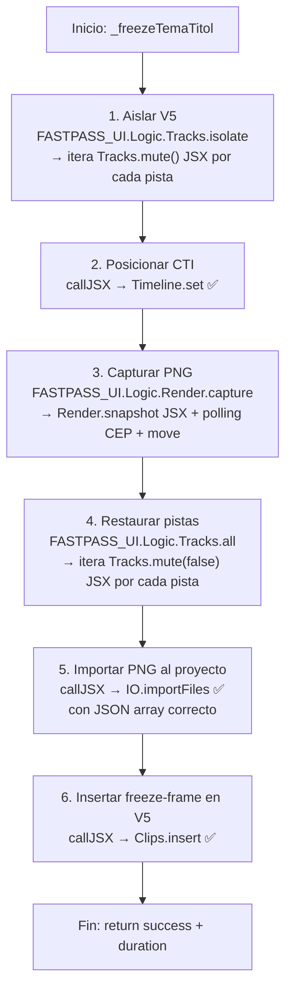

# PLAN: Arreglar el Freeze-Frame de Tema‑Títol

**Fecha**: 2026-05-18
**Estado**: Pendiente de revisión
**Modo**: Architect → Code

---

## 1. Diagnóstico

El método [`_freezeTemaTitol()`](js/workflows/flow_retols.js:244) en [`flow_retols.js`](js/workflows/flow_retols.js) falla con **3 errores JSX** porque **invoca `callJSX()` con nombres de métodos que no existen en el puente JSX**. Los métodos pertenecen a la capa de **Lógica JavaScript**, no a la capa JSX (ExtendScript).

### 1.1 Arquitectura de 2 Capas

```
┌─────────────────────────────────────────┐
│  CAPA JS (Panel HTML)                   │
│  js/logic/5_Tracks_Logic.js             │  ← Tracks.isolate(), Tracks.all()
│  js/logic/9_Render_Logic.js             │  ← Render.capture()
│  js/workflows/flow_retols.js            │  ← _freezeTemaTitol() (AQUÍ ESTÁ EL BUG)
└──────────────┬──────────────────────────┘
               │ callJSX() / cep.fs.evalScript()
               │  SOLO los métodos en $.global.* de jsx/main.jsx
┌──────────────┴──────────────────────────┐
│  CAPA JSX (ExtendScript)                │
│  jsx/main.jsx                           │  ← $.global.Tracks (mute, lock, target, count)
│  jsx/modules/5_Tracks.jsx               │  ← FASTPASS.Tracks (mute, lock, target, count)
│  jsx/modules/9_Render.jsx               │  ← FASTPASS.Render (frame, exportFrameQE, addToAME)
└─────────────────────────────────────────┘
```

### 1.2 Los 3 Errores

| # | Llamada en `_freezeTemaTitol` | ¿Existe en `$.global.*` de `jsx/main.jsx`? | ¿Existe en capa JS Logic? |
|---|------|------|------|
| 1 | `callJSX('Tracks.isolate(...)')` (línea 250) | ❌ No — `$.global.Tracks` solo tiene `count`, `mute`, `lock`, `target` | ✅ `FASTPASS_UI.Logic.Tracks.isolate()` |
| 2 | `callJSX('Render.capture(...)')` (línea 258) | ❌ No — `$.global.Render` solo tiene `frame`, `snapshot`, `queue` | ✅ `FASTPASS_UI.Logic.Render.capture()` |
| 3 | `callJSX('Tracks.all(...)')` (línea 262) | ❌ No — mismo caso que #1 | ✅ `FASTPASS_UI.Logic.Tracks.all()` |

**Causa raíz**: Confusión de capas. Los métodos `isolate`, `capture` y `all` son **composiciones JavaScript** que orquestan múltiples llamadas atómicas JSX. No pueden invocarse vía `callJSX()` porque no existen en el namespace `$.global.*` del puente ExtendScript.

### 1.3 Error Adicional: `IO.importFiles` (latente)

La llamada en línea 270 también tiene un bug de formato:

```javascript
// ❌ INCORRECTO: pasa un string simple, pero IO.importFiles espera JSON array
await callJSX(`IO.importFiles('${utils.escape(snapPath)}')`);
```

[`FASTPASS.IO.importFiles()`](jsx/modules/2_IO.jsx:40) hace `JSON.parse(jsonPaths)` — espera un string JSON array como `'["C:\\...\\file.png"]'`. Al recibir un path simple sin corchetes ni comillas JSON, `JSON.parse()` lanzará excepción.

---

## 2. Solución Propuesta

Reescribir [`_freezeTemaTitol()`](js/workflows/flow_retols.js:244) para que use las funciones de la capa de Lógica JavaScript en lugar de `callJSX()` para los 3 métodos problemáticos.

### 2.1 Diagrama de Flujo Corregido



### 2.2 Cambios Concretos

#### Cambio 1: `Tracks.isolate` → `FASTPASS_UI.Logic.Tracks.isolate()`

```javascript
// ❌ ANTES (línea 250)
await callJSX(`Tracks.isolate(${T_THEME}, 'video')`);

// ✅ DESPUÉS
await FASTPASS_UI.Logic.Tracks.isolate(T_THEME, 'video');
```

[`FASTPASS_UI.Logic.Tracks.isolate()`](js/logic/5_Tracks_Logic.js:50) ya existe. Implementa exactamente lo necesario: itera todas las pistas de video y aplica `mute=true` a todas excepto `trackIdx`.

#### Cambio 2: `Render.capture` → `FASTPASS_UI.Logic.Render.capture()`

```javascript
// ❌ ANTES (líneas 256-259)
const folder = await callJSX("Context.folder()");
const snapPath = `${folder}\\Snapshots\\freeze_${Date.now()}.png`;
const resRaw = await callJSX(`Render.capture('${utils.escape(snapPath)}', ${captureTime})`);
const res = typeof resRaw === "string" ? JSON.parse(resRaw) : resRaw;

// ✅ DESPUÉS
const folder = await callJSX("Context.folder()");
const snapPath = `${folder}\\Snapshots\\freeze_${Date.now()}.png`;
const res = await FASTPASS_UI.Logic.Render.capture(snapPath, captureTime);
```

[`FASTPASS_UI.Logic.Render.capture()`](js/logic/9_Render_Logic.js:21) ya existe. Retorna `{ success: true/false, log: "..." }`. Hace:
1. `Render.snapshot(tempPath, timeSec)` vía JSX → exporta PNG a `C:\temp\`
2. Polling vía `cep.fs.stat` hasta que el archivo aparece
3. `cep.fs.rename` del temp al `destPath` final

#### Cambio 3: `Tracks.all` → `FASTPASS_UI.Logic.Tracks.all()`

```javascript
// ❌ ANTES (línea 262)
await callJSX(`Tracks.all('video', 'mute', false)`);

// ✅ DESPUÉS
await FASTPASS_UI.Logic.Tracks.all('video', 'mute', false);
```

[`FASTPASS_UI.Logic.Tracks.all()`](js/logic/5_Tracks_Logic.js:21) ya existe. Itera todas las pistas del tipo dado y aplica la acción (mute/lock) con el estado indicado.

#### Cambio 4: `IO.importFiles` con formato JSON array correcto

```javascript
// ❌ ANTES (líneas 269-270)
const fileName = snapPath.split("\\").pop();
await callJSX(`IO.importFiles('${utils.escape(snapPath)}')`);

// ✅ DESPUÉS
const fileName = snapPath.split("\\").pop();
const importPayload = JSON.stringify([snapPath]);
await callJSX(`IO.importFiles('${utils.escape(importPayload)}', 'root')`);
```

### 2.3 Código Completo del Método Corregido

```javascript
_freezeTemaTitol: async function (captureTime, stretchEnd, label) {
    const cfg = FASTPASS_UI.Config.get();
    const T_THEME = cfg.tracks.video.tematitol;
    const utils = getUtils();

    // 1. Aïllar V5 (mute a totes les altres pistes de video)
    await FASTPASS_UI.Logic.Tracks.isolate(T_THEME, 'video');

    // 2. Posicionar el cabezal al punt de captura
    await callJSX(`Timeline.set(${captureTime})`);

    // 3. Capturar frame PNG
    const folder = await callJSX("Context.folder()");
    const snapPath = `${folder}\\Snapshots\\freeze_${Date.now()}.png`;
    const res = await FASTPASS_UI.Logic.Render.capture(snapPath, captureTime);

    // 4. Restaurar totes les pistes (unmute global)
    await FASTPASS_UI.Logic.Tracks.all('video', 'mute', false);

    if (!res || !res.success) {
        throw new Error(`Captura fallida: ${res ? res.log : "desconegut"}`);
    }

    // 5. Importar el PNG capturat al projecte
    const fileName = snapPath.split("\\").pop();
    const importPayload = JSON.stringify([snapPath]);
    await callJSX(`IO.importFiles('${utils.escape(importPayload)}', 'root')`);

    // 6. Determinar durada de l'estirament
    let duration;
    if (stretchEnd !== null && stretchEnd !== undefined) {
        duration = Math.max(stretchEnd - captureTime, 0.5);
    } else {
        const timelineDur = parseFloat(await callJSX("Timeline.duration()") || "0");
        duration = Math.max(timelineDur - captureTime, 0.5);
    }

    // 7. Inserir el freeze-frame a V5 amb la durada calculada
    await callJSX(`Clips.insert('${utils.escape(fileName)}', ${T_THEME}, ${captureTime}, ${captureTime + duration}, 'video')`);

    return { success: true, duration };
},
```

---

## 3. Verificación de Dependencias

| Dependencia | Ubicación | Estado |
|---|---|---|
| `FASTPASS_UI.Logic.Tracks.isolate` | [`js/logic/5_Tracks_Logic.js:50`](js/logic/5_Tracks_Logic.js:50) | ✅ Existente |
| `FASTPASS_UI.Logic.Tracks.all` | [`js/logic/5_Tracks_Logic.js:21`](js/logic/5_Tracks_Logic.js:21) | ✅ Existente |
| `FASTPASS_UI.Logic.Render.capture` | [`js/logic/9_Render_Logic.js:21`](js/logic/9_Render_Logic.js:21) | ✅ Existente |
| `callJSX("Timeline.set")` | [`jsx/main.jsx:318`](jsx/main.jsx:318) → [`13_Timeline.jsx:25`](jsx/modules/13_Timeline.jsx:25) | ✅ Existente |
| `callJSX("Context.folder")` | [`jsx/main.jsx:68`](jsx/main.jsx:68) | ✅ Existente |
| `callJSX("IO.importFiles")` | [`jsx/main.jsx:100`](jsx/main.jsx:100) → [`2_IO.jsx:40`](jsx/modules/2_IO.jsx:40) | ✅ Existente |
| `callJSX("Timeline.duration")` | [`jsx/main.jsx:327`](jsx/main.jsx:327) → [`13_Timeline.jsx:67`](jsx/modules/13_Timeline.jsx:67) | ✅ Existente |
| `callJSX("Clips.insert")` | [`jsx/main.jsx:379`](jsx/main.jsx:379) → [`6_Clips.jsx:126`](jsx/modules/6_Clips.jsx:126) | ✅ Existente |

**Todas las dependencias existen en el código actual. No se requiere crear nuevos métodos JSX.**

---

## 4. Notas sobre `Render.capture` y el path de red

[`FASTPASS_UI.Logic.Render.capture()`](js/logic/9_Render_Logic.js:21) usa `cep.fs.rename(tempFileFull, destPath)` para mover el PNG de `C:\temp\` al destino final. Si `destPath` está en una ruta de red (ej. `//public.ad-ccrtv.local/...`), el `cep.fs.rename` **podría fallar** porque CEP fs no siempre soporta rutas UNC.

**Si esto ocurre**, el plan de contingencia es:
- Hacer que `capture` guarde en una ruta local (ej. `C:\temp\`) y luego usar `cep.fs.readFile` + `cep.fs.writeFile` para copiar a la ruta de red, o bien
- Usar `IO.importFiles` directamente desde `C:\temp\` sin mover el archivo

Pero esto es un **riesgo secundario** — el fix principal (los 3 errores JSX) debe resolverse primero.

---

## 5. Resumen de la Intervención

| Archivo | Líneas | Cambio |
|---|---|---|
| [`js/workflows/flow_retols.js`](js/workflows/flow_retols.js) | 244-286 | Reescribir `_freezeTemaTitol`: 3 llamadas `callJSX` → llamadas directas a capa Logic; 1 fix de formato `IO.importFiles` |

**Impacto**: Solo el método `_freezeTemaTitol`. Sin cambios en JSX, sin nuevas dependencias, sin riesgo de regresión en otros flujos.

---

## 6. Verificación Post-Fix

Después de implementar, verificar en Premiere Pro con los 3 casos:
1. **TNV V1** (TN_VESPRE) — Tema-Títols con freeze-frame
2. **TNV V2** (TN_MIGDIA) — Tema-Títols con freeze-frame
3. **TNC V1** (TN_COMARQUES) — posiblemente sin Tema-Títols (verificar que no falla)

El log esperado debe mostrar:
```
📌 Bloc 16: X Tema‑Títol(s) → marcador a Y.YYs
   ✅ Inserit: 16lead_tema_titol_XXXXXX @ Y.YYs
   🖼️ Freeze aplicat: 16lead_tema_titol_XXXXXX → Z.Zs
```
( sin los errores `ERR:Tracks.isolate`, `ERR:Render.capture`, `ERR:Tracks.all` )
